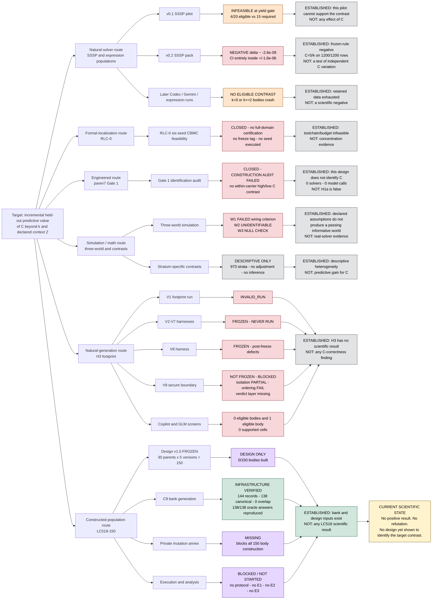

# Failure-Concentration Programme — Development Tree and Claim Audit

**Date:** 2026-11-03
**Repository:** `foued2/failure-concentration-study`
**Branch audited:** `research/concentration-math-spec` @ `8bb2e82`
**Document status:** audit, diagram, and synthesis only. It is **not** a scientific result, a protocol, a freeze, an authorization, or a modification of any frozen artifact. It creates no solver, bank, execution, model call, or inference.

> **Bottom line.** As of 2026-11-03 the programme has **no positive scientific result and no refutation** for failure concentration. It has:
>
> 1. one terminal infeasible natural pilot (v0.1);
> 2. one terminal negative result that is structurally uninformative about independent concentration variation (v0.2);
> 3. one engineered design closed before generation because it could not identify concentration (Gate 1);
> 4. one simulation whose informative world failed its own wiring criterion (W1);
> 5. one H3 measurement route with no scientific run and a blocked V9 boundary;
> 6. one LC518 constructed-population route whose **input bank and generation pipeline are verified**, but whose **150 solver bodies do not exist (0/150)**, whose private mutation annex is missing, and whose analysis design is not in a single ratified state.
>
> The LC518 bank is real, reproducible infrastructure. It is **not** the experiment, and it produces no E1, E2, or E3 estimate.

---

## 0. What this document is and is not

This document answers three questions:

1. **What happened, in order?** — a chronological tree of every phase, branch, freeze, closure, pivot, and terminal outcome.
2. **What does the record actually establish?** — a claim-by-claim audit with evidence paths and explicit limits.
3. **What remains before any LC518 scientific result exists?** — the gate sequence, the missing inputs, and the unresolved design decisions.

It does **not**:

- reopen or re-litigate any frozen result;
- convert design documents, bank generation, or passing tests into findings;
- assert that concentration is predictive or non-predictive;
- authorize solver construction, execution, fitting, or publication;
- alter any file under `engineered-study/`, `v02/`, `rlc0/`, `v03p/`, `next-task/`, `h3-footprint-*`, or `lc518-150/`.

### 0.1 Status vocabulary used here

| Label | Meaning |
|---|---|
| `VERIFIED` | Independently re-derived in this audit from the artifact, hash, blob, or API response cited. |
| `RECORDED_VERIFIED` | Recorded in a committed result and consistent with the surrounding record; not re-executed in this audit. |
| `RECORDED` | Recorded in a committed document; read and cross-checked, but neither re-executed nor re-derived numerically here. |
| `CONFIRMED` | Documentary claim checked against the cited record; no numerical re-derivation required. |
| `DESIGN_ONLY` | A design, protocol, work order, review, or plan. No data and no result. |
| `INFRASTRUCTURE_VERIFIED` | Code, bank, package, or run plumbing verified. Says nothing about the scientific estimand. |
| `INFEASIBLE` | The design or available data cannot produce the target contrast. **Not** a null result. |
| `NEGATIVE_UNINFORMATIVE` | A frozen rule returned negative on a support where the target quantity has no variation. |
| `CLOSED_CONSTRUCTION_FAILURE` | Stopped before generation because identification or constructibility failed. |
| `CRITERION_FAILED` | A predeclared check in a design or simulation failed. |
| `UNIDENTIFIABLE` | The design contains no variation that could estimate the quantity. |
| `NULL_CHECK` | A deliberate null construction returned null. |
| `BLOCKED` | A prerequisite is missing; no valid run is possible. |
| `UNVERIFIED_PROVENANCE` | Asserted, but not confirmable from the material available to this audit. |
| `FALSE` / `FALSE_CATEGORY_ERROR` | The claim is contradicted by the record, or misclassifies what the artifact is. |
| `LOCAL_ONLY` | Exists on this machine but not in the GitHub record. |

---

## 1. The question and the six operationalizations

The programme asks one question in several forms:

> Does structured information about **how** a solver fails — specifically, failure concentration `C = max_j f_j / k` — add held-out predictive value beyond the total failure count `k` and declared context `Z`?

A positive claim would require all of: (i) independent units at the same `k` with different `C`; (ii) a held-out score fixed before outcomes; (iii) a predictive comparison that holds `k` and context fixed; (iv) stability under the prespecified partition and scoring checks. The record shows that no executed study has yet met (i).

| Route | Population | What `C` was | Terminal status | Scientific yield |
|---|---|---|---|---|
| **v0.1** | Natural SSSP submissions | Six input families, 5 probes each | `INFEASIBLE` | 4 eligible bodies, all `C = 5/k`; zero contrast |
| **v0.2** | Natural SSSP pack | Same six-family instrument | `NEGATIVE_UNINFORMATIVE` | 10 distinct eligible bodies; 1200/1200 rows `C = 5/k`; zero contrast |
| **RLC-0** | Six LeetCode 704 seeds | Not a concentration study | `CLOSED` | No concentration evidence; no seed executed |
| **Gate 1** | Engineered `paren7` solvers | Six input families at fixed `k=5` | `CLOSED_CONSTRUCTION_FAILURE` | No within-carrier high/low contrast; 0 solvers built |
| **Three-world** | Synthetic worlds | Six-family vector summary | `CRITERION_FAILED` (W1) | Informative world failed its wiring check; W2 unidentifiable; W3 null |
| **H3** | Naturally generated SSSP candidates | Six-family probes, 30 inputs | `BLOCKED` | No valid run; 0 and 1 eligible bodies in exploratory screens |
| **LC518-150** | Deliberately constructed Coin Change II population | Primary E1 does **not** use `C`; secondary review 2.6 uses `C_D` over eight **input strata** | `BLOCKED` before construction | 0/150 bodies; verified bank only |

Two consequences follow immediately:

1. **The LC518 primary estimand is not the concentration hypothesis.** E1 is the matched within-parent mutation contrast on held-out error loss `L(g,v) = mean 1[incorrect]`. The frozen analysis spec says the legacy six-family concentration statistic is **not an estimand**. The concentration-adjacent question appears only in the secondary E3, and only in the unfrozen review revision 2.6 as Model A vs Model B using `C_D` across eight diagnostic **input strata**, not across defect mechanisms.
2. **No executed design has ever produced a same-`k`, different-`C` contrast with independent solver bodies.** The mathematical possibility is trivial; the empirical support is absent; the construct identification problem is unsolved.

---

## 2. Programme chronology

Two views are given. **Figure 1** is an at-a-glance timeline of the eight phases and their terminal status. **Figure 2** is the full development tree, with every freeze, closure, pivot, and terminal outcome. A standalone copy of the full tree is in `PROJECT_DEVELOPMENT_TREE_2026-11-03.mmd`.

### Figure 1 — Programme at a glance

```mermaid
flowchart LR
  Q["Question<br/>Does C add held-out value<br/>beyond k and context Z?"]
  P1["P1 · 11–12 Oct<br/>Natural SSSP v0.1 / v0.2<br/><b>INFEASIBLE</b> + <b>uninformative NEGATIVE</b>"]
  P2["P2 · 12–14 Oct<br/>RLC-0 formal localization<br/><b>CLOSED — no certification</b>"]
  P3["P3 · 14–20 Oct<br/>v0.3-P Phase 0 design<br/><b>NO FREEZE, NO PHASE 1</b>"]
  P4["P4 · 21–22 Oct<br/>Natural follow-up / expression pilot<br/><b>ZERO ELIGIBLE BODIES</b>"]
  P5["P5 · 23–24 Oct<br/>Engineered paren7 Gate 1<br/><b>CONSTRUCTION AUDIT FAILED</b>"]
  P6["P6 · 24–25 Oct<br/>Three-world + math synthesis<br/><b>W1 FAILED · W2 UNIDENTIFIABLE · W3 NULL</b>"]
  P7["P7 · 26 Oct–1 Nov<br/>H3 footprint engineering<br/><b>NO RESULT · V9 BLOCKED</b>"]
  P8["P8 · 1–3 Nov<br/>LC518-150 constructed population<br/><b>BANK VERIFIED · 0/150 BODIES</b>"]
  Z["2026-11-03<br/><b>NO POSITIVE RESULT<br/>NO REFUTATION</b>"]

  Q --> P1 --> P2 --> P3 --> P4 --> P5 --> P6 --> P7 --> P8 --> Z

  classDef bad fill:#f8d7da,stroke:#842029,color:#000
  classDef infeas fill:#ffe5cc,stroke:#8a4b08,color:#000
  classDef design fill:#e2e3e5,stroke:#41464b,color:#000
  classDef block fill:#e7d6ff,stroke:#59359a,color:#000
  classDef verified fill:#d1e7dd,stroke:#0f5132,color:#000
  classDef note fill:#fff3cd,stroke:#664d03,color:#000

  class P1 infeas
  class P2,P5 bad
  class P3,P4 design
  class P6 bad
  class P7 block
  class P8 verified
  class Z note
```



### Figure 2 — Full development tree

The full tree follows. Status colours are explained beneath it.

```mermaid
flowchart TB

  Q["CENTRAL QUESTION<br/>Does failure concentration C add held-out predictive value<br/>beyond failure count k and declared context Z?"]
  Q --> A1

  subgraph P1["PHASE 1 - 11-12 Oct 2026 - Natural SSSP v0.1 then v0.2"]
    direction TB
    A1["v0.1 PROTOCOL v2 draft<br/>SSSP - 30 probes - 6 input families - 5 probes per family"]
    A2["v0.1 freeze 5bf80b7<br/>G1 240/240 - G2 6/6 - G3 0/60"]
    A3["Pilot: 20 single-shot submissions<br/>eligible 4/20 = 20 percent vs 75 percent gate"]
    A4["TERMINAL: INFEASIBLE<br/>4 eligible bodies at k in 5,10,25<br/>all C = 5/k - 0 same-k different-C pairs"]
    A5["v0.2 freeze 798b446<br/>pack = 40 bodies x 3 byte-identical replicas"]
    A6["40 confirmatory instances<br/>1200 eligible solver-instance pairs"]
    A7["TERMINAL: NEGATIVE under frozen rule<br/>delta = -2.638929627596376e-09<br/>95 percent CI -1.5187e-06 to 1.5827e-06"]
    A8["Interpretability audit<br/>1200/1200 rows have C = 5/k<br/>Model B adds no column-space capacity<br/>NEGATIVE is uninformative about independent C"]
    A1 --> A2 --> A3 --> A4
    A5 --> A6 --> A7 --> A8
  end

  A4 --> B1
  A8 --> B1

  subgraph P2["PHASE 2 - 12-14 Oct 2026 - RLC-0 formal-localization feasibility"]
    direction TB
    B1["RLC-0 contract and freeze candidate<br/>6 LeetCode 704 seeds - CBMC route"]
    B2["C2 audit: no full-domain certification<br/>canaries OOM INCOMPLETE - canary-FAIL half not observed"]
    B3["CLOSED: bounded negative conclusion<br/>no rlc0-freeze tag - no seed compiled or executed"]
    B1 --> B2 --> B3
  end

  B3 --> C1

  subgraph P3["PHASE 3 - 14-20 Oct 2026 - v0.3-P Phase 0 design"]
    direction TB
    C1["Phase 0 preflight design<br/>2026-10-14 - document only"]
    C2["Revisions D, E, F, G and review packages<br/>M3 addendum - O2 - A1 - NC1 - target bridge"]
    C3["NO FREEZE - NO PHASE 1<br/>A/B/C/E open freeze blockers<br/>VDraft numerical conversion PROVISIONAL"]
    C1 --> C2 --> C3
  end

  C3 --> D1

  subgraph P4["PHASE 4 - 21-22 Oct 2026 - Natural-solver follow-up and expression pilot"]
    direction TB
    D1["Separate feasibility-first protocol frozen<br/>Gemini provider amendment"]
    D2["Gemini pilot closed at usage cap<br/>no eligible generated bodies"]
    D3["Expression pilot: 30 attempt dirs<br/>19 validated - 13 k>=2 crash - 6 k=0"]
    D4["ZERO eligible k>=2 expression bodies<br/>infrastructure/feasibility observation"]
    D5["Natural-solver closure record drafted<br/>CLOSURE_RECORD_FOR_APPROVAL_NO_AUTHORIZATION"]
    D1 --> D2 --> D4
    D1 --> D3 --> D4
    D4 --> D5
  end

  D5 --> E1

  subgraph P5["PHASE 5 - 23-24 Oct 2026 - Engineered task-specific route"]
    direction TB
    E1["Gate 1 - paren7_min_insertions<br/>128-input domain - 30 diagnostic + 98 evaluation"]
    E2["Target design: 6 profiles at C=1 plus 1 profile at C=0.2<br/>all at k=5"]
    E3["Identification failure<br/>no within-carrier high/low contrast<br/>C not separable from family or defect identity"]
    E4["Option B bounded construction audit<br/>257 hand-built instances - 14 at k=5<br/>0 genuinely different mechanism pairs with matched profiles"]
    E5["CLOSED - CONSTRUCTION AUDIT FAILED<br/>0 study solvers - 0 model calls - Gate 2 not authorized"]
    E6["Calibration control result<br/>at fixed k=5 and C=1 score ranges 0.683673 to 0.969388<br/>high-C control 0.833333 < low-C 0.887755"]
    E1 --> E2 --> E3 --> E4 --> E5
    E4 --> E6
  end

  E5 --> F1

  subgraph P6["PHASE 6 - 24-25 Oct 2026 - Simulation and mathematical synthesis"]
    direction TB
    F1["Concentration mathematical specification<br/>C = max(F)/k is a deterministic summary of vector F"]
    F2["Three-world simulation - 2.5M cases per world"]
    F3["W1 FAILED frozen wiring criterion<br/>domain C gain 1.961e-06 CI -1.242e-06 to 7.581e-06<br/>alternate partition flips negative"]
    F4["W2 UNIDENTIFIABLE<br/>C=1 for every eligible case - residualized C variance 0"]
    F5["W3 NULL CHECK<br/>oracle C-after-defects ~0 - no positive gain"]
    F6["Independent W1 verification<br/>bit-strict reproduction - W1 remains FAILED"]
    F7["Stratum contrasts - 973 carrier x k strata<br/>756 with >=2 C levels - descriptive only<br/>no adjustment - no inference"]
    F8["Construct-validity assessment 2026-10-25<br/>not demonstrated and not refuted<br/>natural data infeasible - engineered design failed - W1 failed"]
    F1 --> F2 --> F3 --> F6
    F2 --> F4
    F2 --> F5
    F2 --> F7
    F6 --> F8
    F7 --> F8
  end

  F8 --> G1

  subgraph P7["PHASE 7 - 26 Oct to 1 Nov 2026 - H3 footprint gate engineering"]
    direction TB
    G1["H3 frozen family partition - 30 SSSP probes<br/>6 families - eligible 2<=k<=24 - 40-group PASS target"]
    G2["V1 run - INVALID_RUN<br/>extractor discarded module imports<br/>module-load errors became 30 failed probes"]
    G3["V2-V7 - frozen but never run<br/>extraction - saturation - futility - AST classifier - other policy - isolation"]
    G4["V8 - frozen tag h3-footprint-v8-freeze-2026-10-27<br/>post-freeze audit found evaluator and sampling defects"]
    G5["V9 - implementation only - NOT FROZEN<br/>host oracle split - fail-closed gate - provenance hardening"]
    G6["V9 blockers<br/>isolation battery PARTIAL - rendezvous ordering FAIL<br/>verdict layer NOT_IMPLEMENTED - generation/evaluation BLOCKED"]
    G7["Copilot-Auto screen 2026-10-29<br/>12 requests - 9 unique solvers - 0 eligible bodies"]
    G8["GLM screen 2026-10-29<br/>12 requests - 1 eligible body k=9 C=4/9 - 21/30 correct<br/>0 supported cells because m_min=4"]
    G9["Independent audit of GLM evidence<br/>score exactly reproduced - classifier error request-03 floyd to bfs"]
    G10["Taxonomy and cell-rules decision record<br/>DRAFT - NOT FROZEN - NOT APPROVED"]
    G1 --> G2 --> G3 --> G4 --> G5 --> G6
    G1 --> G7 --> G9
    G1 --> G8 --> G9
    G9 --> G10
  end

  G6 --> H1
  G10 --> H1

  subgraph P8["PHASE 8 - 1-3 Nov 2026 - LC518-150 constructed population and C9 bank"]
    direction TB
    H1["LC518-150 design package v1.0 FROZEN<br/>30 parents in 5 families K1 7 - K2 8 - K3 8 - K4 5 - K5 2"]
    H2["150 bodies planned<br/>S0 control - SA - SB - SAB - S-extra<br/>30 controls + 90 single + 30 double"]
    H3["BLOCKED at private annex<br/>eight-mechanism taxonomy and 28-pair schedule absent<br/>mutation assignment and all source writing stop"]
    H4["Banks designed before bodies<br/>64 diagnostic + 80 held-out - canonical identity amount plus sorted coins"]
    H5["Analysis v1.0 frozen: E1 matched within-parent contrasts primary<br/>E2 held-out Q - E3 exploratory prediction<br/>legacy six-family concentration explicitly not an estimand"]
    H6["Analysis review revision 2.6 - NOT FROZEN<br/>C_D over 8 diagnostic strata - Models A/B/C<br/>M1 three-parent exact-cell floor - C8/E3 12000-resolved gate"]
    H7["C9 bank-generation revision 2.6<br/>owner ratified LC518-GO-2026-11-03-01<br/>spec blob SHA-256 f291ae87... verified"]
    H8["C9 package reassembled and verified<br/>tar.xz SHA-256 e0be3f2a... - 16/16 SHA256SUMS<br/>73/73 tests pass on CPython 3.13.5 - 1 Windows skip"]
    H9["GitHub Actions run 41591572358 - SUCCESS<br/>run 2026-11-03T06:42:21Z to 06:44:02Z<br/>artifact 13210063805 - 75523 bytes - not expired"]
    H10["Independent bank audit - ALL CHECKS PASS<br/>144 records - 138 canonical - zero overlap<br/>6/6 artifact hashes - 138/138 oracle answers"]
    H11["PROVENANCE LIMIT<br/>run logs and run_manifest not in 12-file publish set<br/>artifact download returns 401 - no anonymous access"]
    H12["SOLVER BODIES: 0 of 150<br/>no execution protocol - no E1 contrasts - no E3 prediction"]
    H1 --> H2 --> H3
    H1 --> H4 --> H7 --> H8 --> H9 --> H10 --> H11
    H5 --> H6
    H3 --> H12
    H10 --> H12
  end

  H12 --> Z["NO LC518 SCIENTIFIC RESULT EXISTS YET<br/>The bank is verified input infrastructure.<br/>E1/E2/E3 are preregistered designs, not findings."]

  classDef terminal fill:#f8d7da,stroke:#842029,color:#000
  classDef infeasible fill:#ffe5cc,stroke:#8a4b08,color:#000
  classDef closed fill:#f5c2c7,stroke:#842029,color:#000
  classDef failed fill:#f1aeb5,stroke:#842029,color:#000
  classDef design fill:#e2e3e5,stroke:#41464b,color:#000
  classDef blocked fill:#e7d6ff,stroke:#59359a,color:#000
  classDef verified fill:#d1e7dd,stroke:#0f5132,color:#000
  classDef warn fill:#fff3cd,stroke:#664d03,color:#000

  class A4 infeasible
  class A7 terminal
  class A8 warn
  class B3 closed
  class C3 design
  class D4 infeasible
  class D5 design
  class E3 closed
  class E5 closed
  class F3 failed
  class F4 infeasible
  class F5 design
  class F8 design
  class G2 failed
  class G3 design
  class G4 failed
  class G5 blocked
  class G6 blocked
  class G7 infeasible
  class G8 infeasible
  class G10 design
  class H3 blocked
  class H6 design
  class H7 verified
  class H8 verified
  class H9 verified
  class H10 verified
  class H11 warn
  class H12 blocked
  class Z terminal
```



**Colour key:** green = verified infrastructure; red = terminal negative or failed criterion; orange = infeasible or no eligible contrast; grey = design/frozen-but-unrun; purple = blocked/not frozen; yellow = caution/provenance limit.

### 2.1 Chronological record in compact form

| Date(s) | Event | Artifact / commit | Status |
|---|---|---|---|
| 2026-10-11 | v0.1 protocol drafted; G1 240/240, G2 6/6, G3 0/60; freeze | `PROTOCOL.md`, `FREEZE.md`, tag `v0.1-freeze` = `5bf80b7` | `DESIGN` → `FROZEN` |
| 2026-10-11 | v0.1 pilot: 20 submissions, eligible 4/20 = 20% vs 75% gate; all eligible `Y=0` | `pilot/PILOT_REPORT.md`, `1612b87` | `TERMINAL INFEASIBLE` |
| 2026-10-12 | v0.2 spec, analysis code, pack 40×3; freeze | tag `v0.2-freeze` = `798b446`; pack `8f83ee8` | `FROZEN` |
| 2026-10-12 | v0.2 terminal: delta `-2.639e-09`, CI `[-1.519e-06, 1.583e-06]`, 40 instances, 1200 pairs | `v02/confirmatory_v02/confirmatory_v02_report.json`, `75cc61f` | `TERMINAL NEGATIVE` |
| 2026-10-13–14 | RLC-0 B0/B0.5/C2 evidence; closure record; no tag, no seed execution | `rlc0/*`, `94fd572` | `CLOSED` |
| 2026-10-14 | v0.3-P Phase 0 design; review response Rev 5 | `v03p/PHASE0_*`, `3cd62b8`, `4018ebd` | `DESIGN_ONLY` |
| 2026-10-15–20 | Revisions D/E/F/G, M3, O2, A1, NC1, target-bridge, calibration/battery | `review/*`, `v03p/*` | `DESIGN/REVIEW` |
| 2026-10-21–22 | Natural follow-up (Gemini) closed; expression pilot; closure draft | `natural-feasibility-pilot/*`, `next-task/*` | `INFEASIBLE/BLOCKED` |
| 2026-10-23 | Gate 1 closed: construction audit failed; 0 solvers, 0 model calls | `engineered-study/GATE1_REPORT.md`, `008abbf` | `CLOSED_CONSTRUCTION_FAILURE` |
| 2026-10-24 | Three-world simulation: W1 FAILED, W2 unidentifiable, W3 null; independent W1 verification | `engineered-study/math/results/three_world/*`, `1150190`, `e7a9a16` | `CRITERION_FAILED` |
| 2026-10-25 | Offline inventory: `INFEASIBLE_WITH_CURRENT_DATA`; construct-validity assessment | `natural-feasibility-pilot/.../INVENTORY_REPORT_2026-10-25.md`, `CONSTRUCT_VALIDITY_ASSESSMENT_2026-10-25.md`, `8bb2e82` | `INFEASIBLE` + `SYNTHESIS` |
| 2026-10-26–27 | H3 V1 invalid run; V2–V8 frozen; V8 post-freeze audit | tags `h3-footprint-*`; `h3-footprint-v8/*` | `INVALID/UNRUN/DEFECTIVE` |
| 2026-10-28–11-01 | H3 V9 implementation; Copilot and GLM screens; taxonomy draft | `h3-footprint-v9/*`, `h3-footprint-v10-cloud/*`, `origin/fix/h3-v9-*` | `BLOCKED` |
| 2026-11-01 | LC518-150 work order, parent design, bank design, analysis spec v1.0 (frozen) | `origin/glm/lc518-150-design-handoff-2026-11-01` | `DESIGN/FROZEN` |
| 2026-11-01–02 | LC518 review v1.2 chain; v1.2.2; C9 dry run; analysis revision 2.6 | `origin/gpt/lc518-150-*` branches | `REVIEW ONLY` |
| 2026-11-02 | GitHub-specific locked C9 package; recovery workflows | `origin/gpt/lc518-github-recovery-2026-11-02` | `INFRASTRUCTURE` |
| 2026-11-03 | Owner GO `LC518-GO-2026-11-03-01`; bank generation run 41591572358 success | `a4ec114`, artifact 13210063805 | `INFRASTRUCTURE VERIFIED` |
| 2026-11-03 | 12-file publish set uploaded; independent audit; 73-test rerun | `e22da84`, local publish set | `AUDIT` |

---

## 3. Route and decision tree

This second diagram separates **what each route established** from **what it did not**. The full standalone copy is `PROJECT_DECISION_TREE_2026-11-03.mmd`; a Graphviz version is `PROJECT_DECISION_TREE_2026-11-03.dot`.



---

## 4. Phase-by-phase record

### 4.1 v0.1 — natural SSSP pilot (2026-10-11)

**Design.** Pre-registered predictive-value study on single-source shortest path. Six input families (unreachable, zero-weight, parallel edge, self-loop, tie multiplicity, weight plateau), 30 diagnostic probes, 5 per family; a disjoint hidden evaluation set. `C = max(F)/k`. Freeze included hash-pinned protocol, instrument, generator, and models.

**Result.** 20 single-shot model submissions. Only **4/20** were eligible (`k>=2`) against a pre-registered gate of **15/20** (75%). All eligible bodies had `Y=0` on every instance. The pilot stopped at the pre-registered outcome: `INFEASIBLE`.

**What it establishes.** The generation route produced too few eligible failures to support the design. The four eligible bodies have `k in {5,10,25}` and `C = 5/k` exactly; there are **zero** same-`k`, different-`C` pairs.

**What it does not establish.** Anything about the predictive value of `C`. The pilot report itself calls the outcome the pre-registered inconclusive branch.

**Artifacts.** `PROTOCOL.md`, `FREEZE.md`, `pilot/PILOT_REPORT.md`, `pilot/pilot_report.json`, `gates/gates_report.json`, tag `v0.1-freeze` (`5bf80b7`), terminal commit `1612b87`.

---

### 4.2 v0.2 — natural SSSP pack (2026-10-12)

**Design.** A 120-file pack that is **40 base bodies × 3 byte-identical replicas**, evaluated on 40 hidden instances. Frozen before pack generation (`v0.2-freeze` = `798b446`). Primary comparison: does a model with `C` improve over a model with `k` and context?

**Result.** `delta = -2.638929627596376e-09`; 95% CI `[-1.5186596329042069e-06, 1.5827074637819738e-06]`; 40 confirmatory instances; 1200 eligible pairs; outcome `NEGATIVE` under the frozen rule (CI upper bound far below the `0.01` threshold).

**Why the negative is uninformative about `C`.** The eligible support contains four `(k,C)` cells, all with `C = 5/k`:

| `k` | `C` | Rows | Distinct base bodies |
|---:|---:|---:|---:|
| 5 | 1.0 | 27 | 3 |
| 10 | 0.5 | 9 | 1 |
| 20 | 0.25 | 9 | 1 |
| 25 | 0.2 | 45 | 5 |

Every row has a fully failed family, so `max(F)=5` and `C=5/k`. Within each `k` there is exactly one `C` level. The model comparison therefore has no independent concentration variation to exploit; the ledger shows Model B adds no column-space capacity on this support. The negative is a valid frozen-rule classification with **no evidential content about concentration's predictive value**.

**Provenance findings retained.** (i) The recorded pack manifest hash (`cc6954...`) is not reproducible from committed artifacts (F9, unresolved). (ii) The generator was first committed after the pack (F10). (iii) The documented output path and structure contradict the implementation (F11). (iv) The run was not blind: intermediate delta/CI and three relabel draws were observed before completion (F7). Content integrity was independently reconstructed (F12); the arithmetic and classification are unaffected.

**Artifacts.** `v02/REPORT_V02.md`, `v02/confirmatory_v02/confirmatory_v02_report.json`, `v02/FINDINGS_LEDGER_2026-10-19.md`, `v02/INTERPRETABILITY_AUDIT_2026-10-14.md`, tag `v0.2-freeze`, terminal commit `75cc61f`.

---

### 4.3 RLC-0 — formal-localization feasibility (2026-10-12–14)

**Design.** A separate track: formal behavioral localization on six LeetCode 704 seeds using CBMC, with a freeze candidate, canary controls, and a C2 audit. It is **not** a concentration study.

**Result.** Full-domain CBMC certification was not demonstrated under the pinned toolchain and budget. Canary runs ended in out-of-memory/incomplete states; the canary-FAIL half of the requirement was not observed. The `rlc0-freeze` tag was never created; no seed was compiled or executed. Closure record: bounded negative conclusion.

**What it establishes.** A feasibility gate can close without answering the scientific question. The route contributes **no** concentration evidence and no `C`–`S` comparison.

**Artifacts.** `rlc0/CONTRACT.md`, `rlc0/FREEZE.md`, `rlc0/evidence/C2/RESULTS.md`, `rlc0/ADDENDUM_2026-10-14.md`, commit `94fd572`.

---

### 4.4 v0.3-P — Phase 0 design (2026-10-14–20)

**Design.** A substantial preflight design for a prospective test, with revisions D, E, F, and G; M3 addendum; O2 and A1 packages; NC1 numerical checks; target-bridge and VDraft review. The Phase 0 document is explicitly **document only**: no solver generation, no hidden-outcome collection, no code implementation, no v0.3 authorization.

**Result.** No freeze. The terminal review response leaves A/B/C/E open as freeze blockers. The VDraft numerical conversion is `PROVISIONAL-PENDING-SOURCE`; the controlling M3/engine texts were not all in the repository. Phase 1 was never authorized.

**What it establishes.** Considerable design and review work, including mathematical auditing; **no empirical result**.

**Artifacts.** `v03p/PHASE0_DESIGN_2026-10-14.md`, `v03p/PHASE0_DESIGN_2026-10-15_RevF.md`, `v03p/PHASE0_REVIEW_RESPONSE_2026-10-14.md`, `v03p/VDRAFT_REVIEW_LOG_2026-10-20.md`, commits `3cd62b8`, `4018ebd`, `edae42c`.

---

### 4.5 Natural-solver follow-up and expression pilot (2026-10-21–22)

**Natural follow-up.** A separate feasibility-first protocol was frozen, with a Gemini provider amendment. The Gemini pilot closed at its usage cap; no eligible generated bodies. An immediate follow-up failed on availability. The route has a **draft closure record** (`CLOSURE_RECORD_FOR_APPROVAL_NO_AUTHORIZATION`), not an approved closure.

**Expression pilot.** 30 attempt directories; 19 passed fail-closed source and host-record validation. All **13** `k>=2` bodies crash on the diagnostic and evaluation suites and are ineligible. The **6** `k=0` bodies are valid but cannot support a fixed-`k` contrast. Zero eligible `k>=2` bodies.

**Offline inventory (2026-10-25).** Across retained natural data: **14** protocol-eligible `k>=2` bodies (4 from v0.1, 10 base bodies from v0.2), and **zero** same-`k`, different-`C` pairs in every dataset. Disposition: `INFEASIBLE_WITH_CURRENT_DATA` (criterion 2), not a null effect.

**Artifacts.** `next-task/06_EXPRESSION_PILOT_RESULT_2026-10-22.md`, `next-task/07_EXPRESSION_PILOT_AUDIT_2026-10-22.md`, `next-task/11_CLOSURE_RECORD_2026-10-22.md`, `natural-feasibility-pilot/offline-inventory-2026-10-25/INVENTORY_REPORT_2026-10-25.md`, commit `766b378`.

---

### 4.6 Engineered `paren7` Gate 1 (2026-10-23–24)

**Design.** One task (`paren7_min_insertions`), a fixed 128-input domain, 30 diagnostic inputs (5 per six structural families), 98 disjoint evaluation inputs. Target design: six `C=1` profiles (five failures localized in one family) plus one `C=0.2` spread profile, all at `k=5`. The question: at fixed `k`, does higher `C` predict higher held-out score after accounting for generator identity and carrier family?

**Result.** Gate 1 **closed as CONSTRUCTION AUDIT FAILED** before generating any study solver:

- no within-carrier high/low `C` contrast;
- `C` is not separable from carrier family or defect identity;
- the evaluation bank is unbalanced across families;
- the calibration controls show score varies at fixed `k=5` and `C=1` from `0.683673` to `0.969388` — a carrier/defect effect;
- the high-`C` control mean (`0.833333`) was **lower** than the low-`C` control (`0.887755`);
- Option B evaluated **257** hand-built mechanism instances; **14** produced `k=5`; **no** mechanism family produced more than one distinct `k=5` concentration profile; **8** cross-mechanism profile matches were found, and **all** had identical full-domain failure sets — **zero** matches between genuinely different mechanisms.

**What it establishes.** A bounded negative **construction** result: this task/design does not operationalize the target contrast. It is not proof that no possible mechanism exists and not evidence that H1a is false.

**Process deviations recorded.** The Option B audit was produced before a separately recorded explicit authorization; a delegated decision is the basis. The historical `selected_profiles.json` SHA-256 is unresolved. These do not invalidate the arithmetic or verdict.

**Artifacts.** `engineered-study/GATE1_REPORT.md`, `engineered-study/08_OPTION_B_CONSTRUCTION_AUDIT_RESULT.md`, `engineered-study/07_PROCESS_DEVIATIONS.md`, `CONSTRUCT_VALIDITY_ASSESSMENT_2026-10-25.md`, commits `008abbf`, `bec5d46`.

---

### 4.7 Three-world simulation and stratum contrasts (2026-10-24–25)

**Design.** A synthetic simulation of three declared worlds, 2.5M cases per world, to show the implications of assumptions — explicitly not an estimate of real solvers.

**Results.**

- **W1** (designed to make concentration informative): frozen wiring check **FAILED**. Domain C gain `1.961346752e-06`, central 95% trial interval `[-1.242089975e-06, 7.581285807e-06]`; equal-family estimate similarly small with an interval including zero; alternate partition flips negative (`-0.000001`, CI `[-0.000003, 0.000003]`). 438 rank warnings per model mean some fold-level parameterizations are not identified.
- **W2** (all `C=1`): **UNIDENTIFIABLE**. 2.5M eligible cases, zero `k=0`, zero overlap strata, residualized C variance `0`.
- **W3** (evaluation damage independent of diagnostic concentration conditional on baseline and latent defect count): **NULL CHECK**. Oracle C-after-defects domain mean `-0.000000`, CI `[-0.000002, 0.000002]`; primary C gain mean `-0.000001`, CI `[-0.000005, 0.000005]`.
- **Independent W1 verification** reproduced the result bit-strictly and confirmed **W1 remains FAILED**.
- **Stratum contrasts**: 973 carrier-by-`k` strata, 756 with at least two observed `C` levels. W1 unadjusted high-minus-low domain-weighted difference `+0.0083141` (92 positive, 36 negative strata). **Descriptive only** — no adjustment, no model fit, no confidence interval, no inference.

**What it establishes.** Under the declared synthetic assumptions, the informative world did not pass its own predictive criterion; one world has no variation; the null world behaves as a null. Positive descriptive contrasts can arise because `C` proxies latent structure (as W3 illustrates), not because `C` carries incremental predictive value.

**Artifacts.** `engineered-study/math/results/three_world/11_THREE_WORLD_SIM_RESULT.md`, `12_POST_RUN_REVIEW_CORRECTIONS_2026-10-24.md`, `15_STRATUM_SPECIFIC_CONTRASTS_REPORT_2026-10-25.md`, `independent_w1_glm/INDEPENDENT_W1_VERIFICATION_REPORT.md`, commits `1150190`, `e7a9a16`, `0487bf8`.

---

### 4.8 H3 footprint gate (2026-10-26–11-01)

**Design.** A 30-probe, six-family SSSP instrument; eligible `2<=k<=24`; target 40 provenance groups for PASS; up to 400 batches × 8 candidates; futility checkpoints at 100/200/300 batches; structural algorithm classification; supported cells require `m_min=4` per `C` level.

**Version history.**

- **V1**: `INVALID_RUN`. The extractor discarded module-level imports; module-load errors became 30 failed probes. Not a scientific result.
- **V2–V7**: frozen but **never run**. Repairs included complete-module extraction, saturation-rate degeneracy, futility, conservative AST classifier, other-category policy, and isolation.
- **V8**: frozen at `h3-footprint-v8-freeze-2026-10-27` (`d5b002c`). A post-freeze audit found evaluator and sampling-control defects that sandbox testing could not fix; V8 is untouched but not a valid basis for a run.
- **V9**: implementation only, **not frozen**. Splits host oracle/controller from sandbox supervisor/child, requires a verified Windows Sandbox attestation and a fail-closed gate, and hardens provenance. `STATUS.json` records: `unit_tests` `NOT_RUN`; `sandbox_isolation_report` `PARTIAL`; `sandbox_rendezvous_ordering` `FAIL`; `verdict_and_support_cells` `NOT_IMPLEMENTED`; `candidate_generation` `BLOCKED`; `candidate_evaluation` `BLOCKED`. The isolation battery stopped after the inbox-write probe because the harness wrongly required the writable outbox to deny writes; process-tree and normal-exit probes never ran. The outbox is candidate-writable and the host cannot authenticate supervisor authorship — a remaining blocker.
- **V10 / hosted prototypes**: engineering work on Docker and hosted executors, adversarial fixtures, provider smokes. No H3 scientific run.

**Exploratory screens.**

- **Copilot-Auto (2026-10-29)**: 12 requests, 9 unique solvers, **0 eligible bodies**. Actual model identity not exposed or verified.
- **GLM (2026-10-29)**: 12 requests, **1 eligible body**: `k=9`, family counts `A:4, I:1, S:4`, `C=4/9=0.4444`, 21/30 correct. **0 supported cells** because `m_min=4`. An independent audit re-derived the score exactly from raw answers against the frozen v3 expected values and found one classifier error: `request-03` is labelled `floyd` but is a weighted first-discovery/BFS traversal. The label came from the repository's own classifier and was passed through unmodified.
- **Taxonomy/cell-rules decision record (2026-10-30)**: `DRAFT FOR SCIENTIFIC REVIEW — NOT FROZEN — NOT APPROVED`.

**What it establishes.** The H3 route has **no scientific result**. It has engineering progress, invalid or unrun harnesses, a blocked measurement boundary, and two exploratory screens that cannot form a supported cell. It does not establish anything about `C` and correctness.

**Artifacts.** `h3-footprint-v8/README.md`, `h3-footprint-v9/README.md`, `h3-footprint-v9/STATUS.json`, `h3-footprint-v10-cloud/observed-results/COPILOT_AUTO_SCREEN_2026-10-29.md`, `h3-footprint-v10-cloud/glm-agent-feasibility-2026-10-29/GLM_H3_FEASIBILITY_REPORT.md`, `h3-footprint-v10-cloud/observed-results/GLM_H3_EVIDENCE_AUDIT_2026-10-29.md`, `h3-footprint-v10-cloud/observed-results/H3_TAXONOMY_AND_CELL_RULES_DECISION_RECORD_DRAFT_2026-10-30.md`.

---

## 5. LC518-150: design, bank, and what does not yet exist

### 5.1 Design of record

| Element | Content | Status |
|---|---|---|
| Population | 30 parent implementations of Coin Change II in five algorithm families (K1×7, K2×8, K3×8, K4×5, K5×2) | `FROZEN v1.0` |
| Versions | Five per parent: `S0` control, `SA`, `SB`, `SAB`, `S-extra` = 150 bodies (30 + 90 + 30) | `FROZEN v1.0` |
| Diagnostic bank | 64 records: D1–D8, 8 each; D6 contains 4 canonical instances × 2 orderings | `GENERATED` |
| Held-out bank | 80 records: H1 12, H2 12, H3 8, H4 8, H5 10, H6 10, H7 8, H8 12 | `GENERATED` |
| Canonical identity | `(amount, tuple(sorted(coins)))`; no identity may cross banks | `VERIFIED` |
| Analysis v1.0 | E1 matched within-parent contrasts (primary); E2 held-out `Q`; E3 baseline-vs-enriched prediction (secondary) | `FROZEN` |
| Analysis review 2.6 | `C_D` over 8 diagnostic strata; Models A (baseline), B (+`C_D`), C (+full profile); M1 three-parent exact-cell floor; sensitivity knots `{1,2,3,4,8,16,32,48}`; C8/E3 all-12,000-resolved gate | `NOT FROZEN` |
| Mutation design | Eight-mechanism taxonomy + all 28 unordered pairs + 2 preselected replications + balanced `S-extra` | **MISSING (owner annex)** |

**The critical distinction.** The frozen v1.0 analysis spec states that the legacy six-family concentration statistic is **not an estimand** in LC518. E1 is a matched mutation-contrast study on held-out error loss:

```
L(g,v) = mean over the frozen held-out bank of 1[solver is incorrect]
A-only:      L(g,SA) - L(g,S0)
B-only:      L(g,SB) - L(g,S0)
S-extra:     L(g,S-extra) - L(g,S0)
Pair:        I(g,A,B) = L(g,SAB) - L(g,SA) - L(g,SB) + L(g,S0)
```

It does not use `C` at all. The concentration question is the **secondary** review-2.6 Model A vs Model B comparison, using `C_D` across eight **input strata**, not defect mechanisms. Therefore:

- A successful E1 would be a result about matched mutation effects and interactions, **not** about failure concentration.
- The original programme question maps to E3, and only in the unfrozen 2.6 revision is there a dedicated concentration arm.
- The new `C_D` is a different construct from the legacy six-family `C`; results would not be transportable between them without argument.

### 5.2 What was generated

The C9 bank-generation protocol was owner-ratified as `LC518-GO-2026-11-03-01`, pinned to:

- design-of-record commit `511bc2099ecff74b4f850b169ceef7f853c334a0`;
- file `lc518-150/review-v1.2/analysis-revision-2026-11-02/C9_GENERATION_SPEC_REVIEW.md`, revision 2.6;
- blob SHA-256 `f291ae879ef6e046c6715bb0e6a84cd5a3f5e69f07ace09e213db9b84d8b87fe` (verified in this audit against the raw Git blob: 49,769 bytes, LF endings);
- seeds `20261101` (held-out) and `11052026` (diagnostic);
- runner `ubuntu-24.04`, image `ubuntu24 / 20261026.354.1`, CPython 3.13.5 at `/opt/hostedtoolcache/Python/3.13.5/x64/bin/python3.13`;
- activation diffs that change only `BANK_GENERATION_AUTHORIZED` from `False` to `True`.

The owner GO scope is **bank generation only**. The protocol's `other_authorities` block records: `candidate_execution=False`, `merge_to_master=False`, `power_study=False`, `predictive_fitting=False`, `private_annex_access=False`, `repository_push_by_generator=False`, `solver_construction=False`.

### 5.3 Independent bank audit (re-performed 2026-11-03)

The publish set was extracted from `e22da84:lc518-publish-set-12-files-run-41591572358.zip`. An independent audit script re-read the bank JSON, recomputed canonical identities, rehashed every artifact, and recomputed every oracle answer with two DP formulations.

| Check | Result |
|---|---|
| Record counts | 64 diagnostic + 80 held-out = **144** |
| Unique canonical inputs | 60 diagnostic + 78 held-out = **138** |
| Canonical overlap | **0** |
| Six artifact SHA-256 hashes vs `canonical_disjointness_report.json` | **6/6 match** |
| Record hashes, canonical IDs, oracle-file references | all valid |
| Domain constraints (`n`, `amount`, distinctness, bounds) | all valid |
| Stratum counts | D1–D8 = 8 each; H1 12, H2 12, H3 8, H4 8, H5 10, H6 10, H7 8, H8 12 |
| D6/H6 permutation pairs | adjacent, same canonical identity, different order |
| D5 revised exemplars | `[1,4,5,6,9]` amount 8 and `[1,2,4,5,6]` amount 9 present (C9 2.6, not v1.0) |
| H1/H2/H3/H4 repeated-use witnesses | `[2,3]`@12, `[2,58]`@60, `[50]`@100, `[4,96]`@100 present |
| Oracle recomputation | **138/138 match** |
| Answer range | min `0`, max `284134`; all fit signed int32 |
| int32 redraws | **0** |
| Rejection sidecars | 37 diagnostic + 26 held-out events; parse cleanly |

The audit's own summary reports `failures: []`. This is a strong verification of the **input infrastructure**.

### 5.4 Test suite (re-executed 2026-11-03)

The full C9 generation package was reassembled from five base64 parts on `origin/gpt/lc518-github-recovery-2026-11-02`. The combined `.tar.xz` SHA-256 is `e0be3f2a91e8d71fc0ecfd6cc8eb4621ddb7e9b3a094ad08152423677c1e0ac5`; all **16/16** `SHA256SUMS` entries match.

On CPython 3.13.5:

```
Ran 73 tests in 13.700s
OK (skipped=1)
```

Composition: 43 generator tests, 14 launcher tests, 16 dispatch-gate tests. The one skip is a Windows-only symlink test because symlink creation is unavailable; the pinned target is Linux/CPython 3.13.5, where the CI run executed the same suite.

**What this establishes.** The generator, launcher refusal path, gate, and provenance mechanics behave as specified. **It is not scientific evidence**: no solver is executed and no outcome is produced.

### 5.5 GitHub Actions run forensics

Anonymous GitHub REST API queries on 2026-11-03 returned:

| Field | Value |
|---|---|
| Run | `41591572358` |
| Workflow | `LC518 C9 bank generation (separate owner GO required)` |
| Event | `workflow_dispatch` |
| Head branch / SHA | `gpt/lc518-github-recovery-2026-11-02` / `a4ec114` |
| Status / conclusion | `completed` / `success` |
| Created / updated | `2026-11-03T06:42:21Z` / `2026-11-03T06:44:02Z` |
| Job | `Verify authorization, generate, and preserve complete run` — success |
| Steps | checkout, install pinned CPython 3.13.5, reassemble/verify/unpack package, verify 16 hashes, run full suite, compile activation candidates, verify protocol/GO/interpreter, invoke launcher, upload artifact — **all success** |
| Artifact | `13210063805`, name `lc518-bank-run-41591572358-1`, size `75,523` bytes, not expired |

The pinned runner identity is valid at the reference level: the official `actions/runner-images` release `ubuntu24/20261026.354` states `Image Version: 20261026.354.1`. The successful gate/launcher steps imply that exact identity was accepted at run time. The latest `ubuntu24` release is now `20261101.360`, so a future rerun on the moving `ubuntu-24.04` label may fail closed.

### 5.6 Provenance limits (important)

1. The 12-file publish set contains **no** `logs/run_manifest.json`, `logs/stdout.log`, or `logs/stderr.log`, even though the protocol's artifact policy requires them in `RUN_ROOT`. The set contains: protocol, generator, launcher, two test files, four bank JSON files, two rejection sidecars, and the disjointness report.
2. The GitHub artifact is **not anonymously downloadable**: the archive endpoint returns `401 Requires authentication`.
3. Therefore the link between run `41591572358` and the published bank is **strong but indirect**: the run succeeded under the owner GO and hash gates; the publish zip is named for the run; the bank hashes match the committed disjointness report; and the bank content matches C9 2.6's revised exemplars and witnesses. What cannot be independently checked from logs is the seed stream, interpreter identity, rejection sequence, and run-root manifest.
4. The C9 revision 2.6 is owner-ratified for this execution, but the historical `BANK_DESIGN.md` was **not** edited. The bank's design authority is the ratified C9 replacement text + owner GO, not the unmodified v1.0 file.
5. The publish commit `e22da84` ("Add files via upload") is a separate manual upload, not a CI commit. This is acceptable for the bank artifacts but is not an end-to-end signed provenance chain.

**Label:** `INFRASTRUCTURE_VERIFIED` with `UNVERIFIED_PROVENANCE` for the run-log layer.

> **2026-11-11 update — provenance items 1–3 above are superseded; items superseded in place, history preserved.** Full detail: `B1_DECISION_RECONCILIATION_2026-11-11.md` §6.
>
> 1. The original Actions artifact was retrieved and digest-verified: `6e6d60c1cb703ed80c1d4fc8191ad764a81b3c06517caeff9db15bf52db2bbe2` equals GitHub's recorded digest for artifact `13210063805`. Its `logs/run_manifest.json` self-verifies (stderr `76a92c24…`, stdout `e3b0c442…` = empty, exit 0, ACCEPTED, seeds diagnostic `11052026` / held-out `20261101`, rejection_event_count 63, test_suite_pass_count 57). The seed-stream, interpreter, and rejection-sequence layers named in item 3 are therefore **manifest-verified**, with the manifest being the launcher's own run-time record (not independent host telemetry).
> 2. The runner-image pin is verified in the executed bytes (`lc518_launcher.py:27-28,319` exact-match refusal), and the workflow sets no `ImageOS`/`ImageVersion` override, so run-time env equaled the pin. The third-party job-log header reading (`20261025.353.1`) remains unconfirmable (403; no such release tag) — this discrepancy stays open (L10 `DISCREPANCY_OPEN` in `CLAIM_AUDIT_MATRIX_2026-11-05.csv`).
> 3. The publish-set ↔ artifact comparison is closed at byte level without the (since-deleted) local ZIP: the publish set recovered from commit `e22da84` (blob `301e8e16…`, SHA-256 `16ce5a6a…`) is **12/12 byte-identical** to the original artifact (i.e., exactly the artifact minus the three log files), and the containment repack (SHA-256 `71f1e76b…`, branch `lc518-containment/foued2-patch-1`) is **10/10 byte-identical** (publish set minus generator/launcher). One hash-verified lineage; run logs retained only in the artifact.
> 4. Independent re-execution of the 2026-11-10 verification bundle on CPython 3.13.5: 91/91 PASS, byte-identical to its shipped ledger. Note: that script's "(140 entries)" oracle label is stale hard-coded text; the actual verified oracle rows are **138** (60 diagnostic + 78 held-out) covering all 144 records.
> 5. Held-out-material exposure: the repository is public and the non-expired artifact contains `heldout_bank.json` **and its oracle answers**; per the B1 decision record §4 the bank supports only a fixed-bank developmental evaluation, never a "sealed evaluation" claim. The current held-out bank is development data.
> 6. Scope note on item 4 above: the Nov 5 decision record states C9 rev 2.6 "is not adopted and does not, as written, establish the B1 comparison" — that concerns analysis authority for B1; the statement here concerns the bank-execution gate provenance. Both hold in their own scopes.

### 5.7 What the bank does and does not establish

**Does establish:**

- the input distribution exists, is deterministic, is internally consistent, and is disjoint across diagnostic/held-out;
- the oracle is correct on all 138 canonical inputs;
- the generation pipeline is reproducible and gate-protected;
- the C9 revision 2.6 construction rules were actually applied (D5 exemplars, H witnesses, D6/H6 pairs, rejection sidecars).

**Does not establish:**

- that any solver fails on any input;
- that `C` or `C_D` varies at fixed `k` among the planned bodies;
- that the 150-body population is constructible or diverse;
- any E1, E2, or E3 estimate;
- any power, MDE, or generalization claim;
- that the LC518 study answers the original concentration question.

---

## 6. Claim audit matrix

The full machine-readable matrix with 59 rows is `CLAIM_AUDIT_MATRIX_2026-11-03.csv`. The tables below reproduce the load-bearing claims. Every row states what the evidence supports **and** what it does not.

### 6.1 Programme-level claims

| ID | Claim | Status | Evidence | Limit |
|---|---|---|---|---|
| P01 | The target is incremental held-out predictive value of `C` beyond `k` and context, not a causal effect | `DESIGN_INTENT` | `CONSTRUCT_VALIDITY_ASSESSMENT_2026-10-25.md` §§1–2 | No design has estimated it |
| P02 | At fixed `k`, `C` can differ mathematically | `ARITHMETIC` | Same, §2 | Does not show solvers realize it without changing defect identity |
| P03 | No positive predictive result exists | `CONFIRMED` | All terminal reports through 2026-11-03 | Does not show `C` lacks value |
| P04 | The programme has not refuted `C` | `CONFIRMED` | v0.2 ledger F13; construct-validity assessment §4 | No “no effect” language is licensed |
| P05 | The central construct has not been operationalized in any executed design with same-`k`, different-`C` independent bodies | `CONFIRMED` | v0.1/v0.2/inventory/Gate 1/W1/H3/LC518 records | A future design could still do so |

### 6.2 v0.1 and v0.2

| ID | Claim | Status | Evidence | Limit |
|---|---|---|---|---|
| N01 | v0.1 terminated `INFEASIBLE` at 4/20 eligible vs 15 required | `RECORDED_VERIFIED` | `pilot/PILOT_REPORT.md`; `1612b87` | Not a concentration test |
| N02 | v0.1 eligible support is 4 bodies, `C=5/k` | `RECORDED` | Ledger F1; inventory | Zero contrast |
| N03 | v0.2 delta `-2.638929627596376e-09`, CI `[-1.5186596329042069e-06, 1.5827074637819738e-06]`, 40 instances, 1200 pairs | `VERIFIED` | `v02/confirmatory_v02/confirmatory_v02_report.json`; `RESULT_V02.md` | Not evidence about independent `C` |
| N04 | v0.2 has `C=5/k` on 1200/1200 eligible rows | `RECORDED_VERIFIED` | Ledger F1–F3 | Frozen-rule classification, not substantive test |
| N05 | The 1200 pairs are 400 cells × 3 replicas from 10 base bodies | `RECORDED` | Ledger F4 | No solver-population claim |
| N06 | The v0.2 pack manifest hash is not reproducible | `UNRESOLVED_PROVENANCE` | Ledger F9; `FREEZE_V02.md:23` | Does not establish alteration |
| N07 | v0.2 was not blind (intermediate delta/CI observed) | `RECORDED` | `REPORT_V02.md` §1; F7 | Arithmetic unaffected |
| N08 | No retained natural dataset has a same-`k`, different-`C` pair | `CONFIRMED` | Inventory 2026-10-25 | Not a universal impossibility result |

### 6.3 RLC-0, v0.3-P, natural follow-up

| ID | Claim | Status | Evidence | Limit |
|---|---|---|---|---|
| R01 | RLC-0 closed without full-domain certification | `CONFIRMED` | `rlc0/ADDENDUM_2026-10-14.md`; `C2/RESULTS.md` | No concentration evidence |
| R02 | No `rlc0-freeze` tag; no seed executed | `VERIFIED` | Tag list; closure record | Does not test `C` |
| D01 | v0.3-P is document-only; no Phase 1 | `CONFIRMED` | `v03p/PHASE0_*`; commits `3cd62b8`, `4018ebd` | No empirical result |
| D02 | A/B/C/E freeze blockers remained open | `CONFIRMED` | `PHASE0_REVIEW_RESPONSE_2026-10-14.md`; Rev F | No numerical claim |
| D03 | The v0.3-P review chain is design/review, not a frozen study | `CONFIRMED` | `review/*`; `VDRAFT_REVIEW_LOG_2026-10-20.md` | No result |
| F01 | Natural-route closure record is a draft, not approved | `CONFIRMED` | `next-task/11_CLOSURE_RECORD_2026-10-22.md` | Closure not in force |
| F02 | Expression pilot has 0 eligible `k>=2` bodies (13 crash, 6 `k=0`) | `CONFIRMED` | `next-task/06`, `07`; inventory | Not a scientific negative |
| F03 | 14 eligible `k>=2` bodies total; zero qualifying pairs | `CONFIRMED` | Inventory 2026-10-25 | Does not prove no design can produce variation |
| F04 | Correct label is `INFEASIBLE_WITH_CURRENT_DATA`, not null | `CONFIRMED` | Inventory §1 | No effect estimate |

### 6.4 Engineered Gate 1

| ID | Claim | Status | Evidence | Limit |
|---|---|---|---|---|
| E01 | Gate 1 closed before generating any solver | `CONFIRMED` | `engineered-study/GATE1_REPORT.md`; `008abbf` | Does not show H1a false |
| E02 | No within-carrier high/low `C` contrast; `C` not separable from family/defect | `CONFIRMED` | Gate 1 report; `06_OPTION_B_IDENTIFICATION_AUDIT.md` | Bounded to this task/design |
| E03 | At fixed `k=5, C=1`, scores ranged `0.683673–0.969388`; high-`C` control mean `0.833333` < low-`C` `0.887755` | `RECORDED` | Gate 1 report | Carrier/defect effect, not concentration |
| E04 | Option B: 257 instances, 14 at `k=5`, 0 genuinely different matched pairs | `RECORDED` | `08_OPTION_B_CONSTRUCTION_AUDIT_RESULT.md` | Bounded construction result |
| E05 | `selected_profiles.json` historical hash unresolved | `UNRESOLVED_PROVENANCE` | `07_PROCESS_DEVIATIONS.md` | Does not invalidate verdict |

### 6.5 Simulation

| ID | Claim | Status | Evidence | Limit |
|---|---|---|---|---|
| S01 | W1 failed; domain C gain `1.961e-06`, CI `[-1.242e-06, 7.581e-06]`; alternate partition negative | `VERIFIED` | `11_THREE_WORLD_SIM_RESULT.md` | Synthetic assumptions only |
| S02 | Independent W1 verification reproduced bit-strictly; W1 remains FAILED | `VERIFIED` | `independent_w1_glm/INDEPENDENT_W1_VERIFICATION_REPORT.md` | Does not rescue W1 |
| S03 | W2 unidentifiable; `C=1` everywhere; residualized variance 0 | `VERIFIED` | W2 section | Not a measured zero |
| S04 | W3 null check; oracle C-after-defects ~0 | `VERIFIED` | W3 section | Not a positive finding |
| S05 | Stratum contrasts are descriptive only (973 strata; 756 with ≥2 `C` levels) | `CONFIRMED` | `15_STRATUM_SPECIFIC_CONTRASTS_REPORT_2026-10-25.md` | No adjustment/inference |
| S06 | Positive descriptive contrasts can be latent-structure proxies | `CONFIRMED` | Construct-validity assessment §3.6 | Does not identify a causal/predictive role |

### 6.6 H3

| ID | Claim | Status | Evidence | Limit |
|---|---|---|---|---|
| H01 | V1 is `INVALID_RUN` (lost imports; module-load errors became failures) | `CONFIRMED` | `h3-footprint-v8/README.md`; `ead0e02` | No result |
| H02 | V2–V7 frozen but never run | `CONFIRMED` | V8 README; seven freeze tags | No data |
| H03 | V8 frozen but post-freeze audit found evaluator/sampling defects | `CONFIRMED` | V8/V9 READMEs; post-freeze audit branch | No H3 result |
| H04 | V9 not frozen; generation/evaluation blocked; isolation `PARTIAL`, ordering `FAIL`, verdict `NOT_IMPLEMENTED` | `VERIFIED` | `h3-footprint-v9/STATUS.json` | No outcome |
| H05 | Copilot screen: 0 eligible bodies from 9 unique solvers | `CONFIRMED` | `COPILOT_AUTO_SCREEN_2026-10-29.md`; run `40850263324` | Model identity unverified |
| H06 | GLM screen: 1 eligible body `k=9, C=4/9, 21/30`; 0 supported cells | `VERIFIED` | `GLM_H3_FEASIBILITY_REPORT.md`; `GLM_H3_EVIDENCE_AUDIT_2026-10-29.md` | One body cannot form a cell |
| H07 | Classifier error: `request-03` is weighted first-discovery/BFS, not Floyd | `VERIFIED` | Evidence audit; erratum `ef1bb37` | Score unaffected |
| H08 | Taxonomy/cell-rules record is draft, not approved | `CONFIRMED` | `H3_TAXONOMY_..._DRAFT_2026-10-30.md` | No rules in force |

### 6.7 LC518

| ID | Claim | Status | Evidence | Limit |
|---|---|---|---|---|
| L01 | Design v1.0 frozen: 30 parents, five versions each, 150 bodies | `CONFIRMED` | `PARENT_DESIGN.md`; `GLM_WORK_ORDER.md`; `3e9a29c` | Design only |
| L02 | C9 2.6 blob SHA-256 `f291ae...` matches `511bc20`; owner GO `LC518-GO-2026-11-03-01` | `VERIFIED` | `OWNER_GO_RECORD.md`; protocol JSON; raw blob hash | Ratification covers bank generation only |
| L03 | Banks: 64 + 80 records; 60 + 78 canonical; zero overlap | `VERIFIED` | Disjointness report; bank JSON | Not a power claim |
| L04 | Six artifact hashes match | `VERIFIED` | Disjointness report | File integrity only |
| L05 | 138/138 oracle answers independently reproduced | `VERIFIED` | Oracle outputs | Oracle on these inputs only |
| L06 | All answers int32; max 284134; zero int32 redraws | `VERIFIED` | Banks; sidecars | Not solver behaviour |
| L07 | Rejections: 37 + 26 events; parse cleanly | `VERIFIED` | Rejection sidecars | Not a scientific observation |
| L08 | 73/73 tests pass on CPython 3.13.5; 1 Windows skip | `VERIFIED` | Reassembled package; `unittest_73.log` | Infrastructure, not science |
| L09 | Run `41591572358` success; artifact `13210063805` | `VERIFIED` | GitHub REST API | Does not expose contents |
| L10 | Runner pin `ubuntu24/20261026.354.1` matches official release | `VERIFIED` | Protocol JSON; runner-images release | Run-time identity inferred from gate pass |
| L11 | Run logs and `run_manifest.json` are preserved and inspectable | `UNVERIFIED_PROVENANCE` | 12-file publish set; artifact 401 | Cannot verify seeds/interpreter/run root |
| L12 | The 150 solver bodies exist | **`FALSE`** | LC518 tree: 2 docs, 0 bodies | No E1/E2/E3 can exist |
| L13 | Body construction blocked by missing private annex | `CONFIRMED` | `PARENT_DESIGN.md`; worklog; work order line 45 | Bank generation did not need it |
| L14 | Frozen analysis spec is v1.0; review 2.6 is not frozen/design of record | `CONFIRMED` | `ANALYSIS_SPEC.md`; review README §8 | Current ratified analysis design is v1.0 |
| L15 | No E1/E2/E3 has been computed | `CONFIRMED` | No bodies/execution/analysis outputs | No LC518 scientific result |
| L16 | The 73 tests are scientific evidence for the hypothesis | **`FALSE_CATEGORY_ERROR`** | Tests exercise mechanics only | Tests ≠ estimand |
| L17 | The verified bank is the experiment | **`FALSE_CATEGORY_ERROR`** | Bank has inputs + oracle only | No outcome |
| L18 | LC518 makes a power/MDE claim | **`FALSE`** | `BANK_DESIGN.md` §3; work order line 66; analysis spec §7 | Exploratory by construction |

---

## 7. The six different “negatives” (and what each licenses)

Conflating these is the most common way the record can be over-read. They are not interchangeable.

| Label | Where it occurred | What it means | What it licenses | What it does **not** license |
|---|---|---|---|---|
| **INFEASIBLE** | v0.1 pilot; expression pilot; natural inventory; RLC-0 | The design or data cannot produce the target contrast | “This route cannot answer the question with this support” | “No effect” |
| **NEGATIVE (uninformative)** | v0.2 | The frozen rule returned negative on a support where `C` has no variation | “The frozen comparison is negative” | “`C` has no predictive value” |
| **CLOSED CONSTRUCTION FAILURE** | Gate 1 | The design could not identify `C` separately from family/defect | “This operationalization fails” | “H1a is false” |
| **CRITERION FAILED** | W1 | A predeclared wiring check failed in a synthetic world | “The informative world did not pass its own test” | “Real solvers behave this way” |
| **UNIDENTIFIABLE** | W2 | No variation exists in the design | “Cannot estimate” | “Measured zero” |
| **NULL CHECK** | W3 | A deliberate null construction returned null | “The null construct behaves as designed” | “A positive result elsewhere is impossible” |

The LC518 bank adds a seventh category: **`INFRASTRUCTURE_VERIFIED`** — the pipeline and inputs are correct, but the experiment has not run. It must never be reported as a scientific finding.

---

## 8. What the programme has established

These are the claims this audit is willing to defend at the stated scope.

### 8.1 Substantive findings about designs and evidence

1. **The natural SSSP route is exhausted for the target contrast.** v0.1 yielded 4 eligible bodies; v0.2 yielded 10 distinct eligible bodies; both have `C = 5/k` on every eligible row; later natural runs have `k=0` or crash at `k>=2`; the expression pilot has zero eligible `k>=2`. Across retained natural data: 14 eligible bodies, zero same-`k`, different-`C` pairs. (`CONFIRMED`)
2. **v0.2’s negative is not evidence about concentration.** `C` is a deterministic function of `k` on the realized support; Model B adds no column-space capacity. The near-zero delta is consistent with that degeneracy. (`VERIFIED`/`RECORDED`)
3. **The engineered `paren7` design could not identify the contrast.** No within-carrier high/low `C` pair; 257 hand-built instances produced 14 at `k=5` but zero genuinely different mechanism pairs with matched profiles. (`CONFIRMED`)
4. **The informative synthetic world failed its own criterion.** W1’s family-adjusted C gain interval includes zero; the alternate partition flips sign; an independent replication is bit-strict. (`VERIFIED`)
5. **The H3 route has no scientific result.** V1 invalid, V2–V7 unrun, V8 defective, V9 blocked, screens at 0 and 1 eligible bodies with zero supported cells. (`CONFIRMED`/`VERIFIED`)
6. **The LC518 input infrastructure is correct and reproducible.** 144 records, 138 canonical, zero overlap, 6/6 hashes, 138/138 oracle answers, 0 int32 redraws, 73/73 tests, successful gated run. (`VERIFIED`)

### 8.2 Methodological findings

7. **`C = max(F)/k` is a deterministic summary of the full failure vector.** It cannot be varied while holding `F` fixed. The scientific question is whether the **distribution** of failures carries information beyond `k` and context, not whether a scalar can be moved independently of its own inputs.
8. **A positive in-sample coefficient is not the target.** The target requires held-out predictive gain with prespecified uncertainty and stability; none of the executed designs provides it.
9. **Family identity, family size, scoring weights, and defect mechanism are competing explanations.** Gate 1 and W3 show they can produce apparent concentration effects. A future design must hold them visible or fix them.
10. **The unit of analysis matters.** v0.2’s 1200 pairs are 400 cells × 3 replicas from 10 base bodies; treating them as 1200 independent solver observations would overstate the evidence.

### 8.3 What is explicitly not established

- that `C` predicts held-out correctness;
- that `C` does not predict it;
- that any mutation/interaction has a particular effect;
- that the LC518 150-body population is constructible, diverse, or executable;
- that `C_D` (eight input strata) and the legacy six-family `C` measure the same construct;
- that the bank generation run’s logs match the published bank end-to-end;
- any power, MDE, universal taxonomy, or transport claim.

---

## 9. What remains before any LC518 scientific result exists

The LC518 route is the only live constructed-population route. Its current state is **design + verified banks + zero bodies + no ratified current analysis**. The gate sequence is:

| Gate | Requirement | Current status | Blocker / owner |
|---|---|---|---|
| **G0 — Private annex** | Eight-mechanism taxonomy; all 28 unordered pairs; two preselected replications; balanced `S-extra` assignments | **MISSING** | Owner must deliver the private annex; GLM correctly stopped at the stop rule |
| **G1 — Analysis design ratification** | Resolve v1.0 vs review 2.6; freeze the current spec; confirm M1 three-parent exact-cell floor, sensitivity knots, C8/E3 resolved gate, `C_D` definition, model A/B/C, `NOT_ESTIMABLE` rules | **BLOCKED** | v1.0 is frozen but superseded in review; 2.6 is review-only. No single ratified current spec |
| **G2 — 150-body construction** | 30 parents × 5 versions; opaque IDs; static syntax/AST/count checks only; sealed manifest kept off-repo | **NOT STARTED (0/150)** | Annex (G0); construction is authorized in principle by the work order but blocked |
| **G3 — Static acceptance** | Exactly 150 files, 30 groups, five roles each, 28-pair schedule + 2 replications, ≥4 genuine algorithm families, no duplicate bodies | **NOT STARTED** | Depends on G2 |
| **G4 — Execution protocol freeze** | Interpreter, runner, timeouts, memory, `UNRESOLVED` rule, retries, manifest, replay, artifact custody; **separate execution authorization** | **NOT STARTED** | Work order explicitly withholds execution authorization; no protocol exists |
| **G5 — Execution** | 150 bodies × 144 inputs = **21,600 declared body-input executions** (before timeout/retry handling); diagnostic 64 + held-out 80 per body | **NOT STARTED** | G4; no runner, no authorization |
| **G6 — E1 primary analysis** | Matched within-parent contrasts (`A-only`, `B-only`, `S-extra`, pair interaction) on `L(g,v)`; per-input interaction distributions; 30 group-level results | **NOT STARTED** | G5; E1 does **not** use `C` |
| **G7 — E2/E3 secondary analysis** | Held-out `Q`; baseline vs enriched (v1.0); or A vs B (`C_D`) and A vs C (review 2.6); group-wise nested CV; `NOT_ESTIMABLE`/zero-variance handling; exploratory only | **NOT STARTED** | G5 + G1; the concentration arm exists only in the unfrozen 2.6 |
| **G8 — Reporting** | Separate E1/E2/E3; coverage/unresolved counts; construct limits; no power/MDE; no transport | **NOT STARTED** | All above |

**The shortest honest description of the remaining work:**

1. Owner delivers the private mutation annex.
2. The analysis design is ratified in one current text (v1.0 + amendments, or 2.6), with the support rules frozen.
3. 150 bodies are constructed and statically accepted (not executed).
4. A separate execution protocol is frozen and separately authorized.
5. All 150 bodies are executed on both banks; coverage/unresolved outcomes are recorded.
6. E1 is run as the primary matched-contrast analysis; E2 and the exploratory E3 are run separately.
7. Results are reported with the construct limits, and **not** as a test of the legacy six-family `C` unless the `C_D` construct is explicitly bridged.

Even after all of this, the LC518 E3 concentration arm is **exploratory**, has **30 parent groups**, and makes **no power claim**. A null or positive E3 would be a bounded result about `C_D` in this constructed population, not a universal answer about failure concentration.

---

## 10. Repository state and local-only material

### 10.1 Git state at audit time

| Item | Value |
|---|---|
| Current branch | `research/concentration-math-spec` |
| HEAD | `8bb2e82` (2026-10-25, “Add bounded construct-validity assessment”) |
| Upstream | `origin/research/concentration-math-spec` at same commit |
| Commit graph | 463 commits across all refs; 64 branches; 10 tags; **0 merge commits** |
| `master` | `edae42c` (2026-10-14), **0 ahead / 7 behind** `origin/master` (`b3e9874`, 2026-11-03); no upstream configured |
| Worktree | Only preserved untracked local archives (below); no modified tracked files |
| Tags | `v0.1-freeze`, `v0.2-freeze`, `h3-footprint-freeze-2026-10-26`, `h3-footprint-v2..v8-freeze-2026-10-27` |

The branch history is linear (no merges). `origin/master` contains the LC518 workflow entry point (`b3e9874`) and the earlier workflow commit (`a4ec114`); the research branch does not.

### 10.2 Local-only material (preserve; do not delete)

1. **Nested clone** `failure-concentration-study/` — a separate `.git` clone at `ae36765` (2026-10-25), same branch name, 617,956,520 bytes including `.git`. It contains its own untracked `engineered-study/math/results/three_world/{per_trial.json,raw/,stratum_specific_analysis/}`. It is not part of the outer repository.
2. **Three-world raw archive** in the outer worktree:
   - `engineered-study/math/results/three_world/raw/` — 8 `.jsonl.gz` files (`W1`, `W2`, `W3`, `MIX_0_0`, `MIX_0_25`, `MIX_0_5`, `MIX_0_75`, `MIX_1_0`), 560,553,425 bytes;
   - `per_trial.json` — 31,466,869 bytes;
   - `manifest.json` — 6,243 bytes;
   - total payload 592,020,294 bytes.
3. **Second verified copy** at `C:\Users\pakla\failure-concentration-study-archive-backup\` — same volume, hashes verified against the committed manifest (`16af20b8...`). It protects against repository deletion, not disk failure; an off-machine copy remains an open operational item.
4. **LC518 local audit material** under `%TEMP%\opencode\lc518zip\` and `%TEMP%\opencode\lc518pkg\` (publish set, reassembled package, audit script, test log). These are working copies, not repository artifacts.

**Rule:** none of this local-only material is evidence that has been independently replicated by GitHub. It is preserved because it is the only raw record for the three-world simulation and because the publish set is the practical source for the LC518 bank audit.

### 10.3 Recommendation on `master` (no change made)

`master` is 7 commits behind `origin/master` and has no upstream. The divergence is administrative/publication state, not a scientific conflict. A fast-forward to `b3e9874` would align the default branch with the LC518 workflow entry point. **No change was made**, because the user has not authorized it and because the research branch is the current working context. If desired, the safe operation is a fast-forward only (`git merge --ff-only origin/master`), not a merge commit.

---

## 11. Recommendations (ordered; none is an authorization)

1. **Do not run any LC518 solver body.** Execution is not authorized, and there is no execution protocol.
2. **Resolve the analysis-design ambiguity before construction.** Pick one current ratified text. Either (a) keep v1.0 as the design of record and treat 2.6 as a proposal, or (b) ratify 2.6 with the M1 support floor and C8/E3 gate. Do not run an analysis that silently mixes the two.
3. **Obtain the private annex.** Without the eight-mechanism taxonomy, the 28-pair schedule, the two replications, and the `S-extra` balancing, the 150-body population cannot be constructed as specified. Do not invent mechanisms.
4. **Construct, then statically accept, then freeze.** Build 150 bodies under `GENERATED_NOT_EXECUTED`; verify counts, roles, hashes, AST, and duplicate policy; keep the sealed manifest off-repo. Do not call static inspection “mutation isolation verified.”
5. **Write a separate execution protocol.** Pin the interpreter, runner, timeouts, memory, `UNRESOLVED` semantics, retry policy, manifests, and artifact custody. Obtain a separate explicit execution authorization. Do not reuse the bank-generation GO as an execution GO.
6. **Preserve the provenance distinction.** If the run logs cannot be published, record that explicitly and keep the artifact custody chain. Do not describe the bank as “end-to-end verified from logs” when only the artifact and hashes are available.
7. **Keep the scientific language bounded.** Report E1 as matched mutation contrasts, E2 as held-out correctness, E3 as exploratory prediction. Never merge E1 and E3. Never call the bank a result. Never call v0.2 a test of independent `C`.
8. **If the goal is the original concentration question, design a new study.** LC518 E1 does not answer it; E3 is exploratory and uses a different construct (`C_D` across input strata). A direct test still needs independent same-`k`, different-`C` units with family/defect alternatives held visible. The construct-validity assessment’s ten conditions remain the checklist.

---

## Appendix A — Artifact index

### A.1 Terminal results and syntheses

| Artifact | What it is |
|---|---|
| `pilot/PILOT_REPORT.md` | v0.1 terminal `INFEASIBLE` |
| `v02/REPORT_V02.md` | v0.2 terminal `NEGATIVE` + exposure disclosure |
| `v02/confirmatory_v02/confirmatory_v02_report.json` | Persisted v0.2 delta, CI, 40 `delta_i` |
| `v02/FINDINGS_LEDGER_2026-10-19.md` | F1–F13 audit findings, incl. unresolved manifest |
| `rlc0/ADDENDUM_2026-10-14.md` | RLC-0 closure, C2 unsatisfied |
| `v03p/PHASE0_REVIEW_RESPONSE_2026-10-14.md` | Phase 0 design-only status; A/B/C/E blockers |
| `engineered-study/GATE1_REPORT.md` | Gate 1 closure, identification failure, calibration |
| `engineered-study/08_OPTION_B_CONSTRUCTION_AUDIT_RESULT.md` | 257-instance bounded audit |
| `engineered-study/math/results/three_world/11_THREE_WORLD_SIM_RESULT.md` | W1 FAILED, W2 unidentifiable, W3 null |
| `engineered-study/math/results/three_world/independent_w1_glm/INDEPENDENT_W1_VERIFICATION_REPORT.md` | Bit-strict W1 confirmation |
| `engineered-study/math/results/three_world/15_STRATUM_SPECIFIC_CONTRASTS_REPORT_2026-10-25.md` | Descriptive stratum contrasts |
| `CONSTRUCT_VALIDITY_ASSESSMENT_2026-10-25.md` | Programme-wide synthesis and construct limits |
| `natural-feasibility-pilot/offline-inventory-2026-10-25/INVENTORY_REPORT_2026-10-25.md` | `INFEASIBLE_WITH_CURRENT_DATA` |
| `next-task/11_CLOSURE_RECORD_2026-10-22.md` | Natural-route closure draft (unapproved) |

### A.2 H3

| Artifact | What it is |
|---|---|
| `h3-footprint-v8/README.md` | V1 invalid; V2–V7 frozen unrun; V8 boundary |
| `h3-footprint-v9/README.md` | V9 secure boundary; not frozen |
| `h3-footprint-v9/STATUS.json` | Per-gate status ledger (PARTIAL/FAIL/NOT_IMPLEMENTED/BLOCKED) |
| `h3-footprint-v10-cloud/observed-results/COPILOT_AUTO_SCREEN_2026-10-29.md` | 0 eligible / 9 unique solvers |
| `h3-footprint-v10-cloud/glm-agent-feasibility-2026-10-29/GLM_H3_FEASIBILITY_REPORT.md` | 1 eligible body `k=9`, `C=4/9` |
| `h3-footprint-v10-cloud/observed-results/GLM_H3_EVIDENCE_AUDIT_2026-10-29.md` | Score reproduced; classifier error |
| `h3-footprint-v10-cloud/observed-results/H3_TAXONOMY_AND_CELL_RULES_DECISION_RECORD_DRAFT_2026-10-30.md` | Draft rules; not approved |

### A.3 LC518

| Artifact | What it is |
|---|---|
| `lc518-150/glm-handoff/PARENT_DESIGN.md` | 30 parents, five families, 150-body plan |
| `lc518-150/glm-handoff/BANK_DESIGN.md` | 64 + 80 banks, canonical rule, no-power statement |
| `lc518-150/glm-handoff/ANALYSIS_SPEC.md` | Frozen v1.0: E1/E2/E3 |
| `lc518-150/review-v1.2/analysis-revision-2026-11-02/ANALYSIS_SPEC_REVIEW_DRAFT.md` | Review 2.6; `C_D`, Models A/B/C, M1 |
| `lc518-150/review-v1.2/analysis-revision-2026-11-02/C9_GENERATION_SPEC_REVIEW.md` | C9 2.6; blob `f291ae...` |
| `lc518-150/c9-github-generation/OWNER_GO_RECORD.md` | `LC518-GO-2026-11-03-01` |
| `lc518-150/c9-github-generation/execution_protocol_github_v2.json` | Pins runner, interpreter, seeds, hashes |
| `lc518-150/c9-github-generation/SHA256SUMS` | 16/16 verified |
| `publish/bank/*.json` | 64 + 80 banks, oracle outputs, disjointness report |
| `publish/bank/*.rejections.jsonl` | 37 + 26 events |
| `publish/test_lc518_*.py` | 73-test suite |
| `.github/workflows/lc518-github-generation.yml` | Protected dispatch workflow |

### A.4 Audit deliverables

| Artifact | What it is |
|---|---|
| `PROJECT_DEVELOPMENT_TREE_2026-11-03.md` | This document |
| `PROJECT_DEVELOPMENT_TREE_2026-11-03.mmd` | Chronology diagram (Mermaid source) |
| `PROJECT_DEVELOPMENT_TREE_2026-11-03.svg` | Chronology diagram (rendered SVG) |
| `PROJECT_DEVELOPMENT_TREE_2026-11-03.png` | Chronology diagram (rendered PNG) |
| `PROJECT_DECISION_TREE_2026-11-03.mmd` | Route/decision tree (Mermaid source) |
| `PROJECT_DECISION_TREE_2026-11-03.svg` | Route/decision tree (rendered SVG) |
| `PROJECT_DECISION_TREE_2026-11-03.png` | Route/decision tree (rendered PNG) |
| `PROJECT_DECISION_TREE_2026-11-03.dot` | Route/decision tree (Graphviz source) |
| `PROJECT_DECISION_TREE_2026-11-03.graphviz.svg` | Route/decision tree (Graphviz SVG, one-page wide layout) |
| `PROJECT_DECISION_TREE_2026-11-03.graphviz.png` | Route/decision tree (Graphviz PNG) |
| `CLAIM_AUDIT_MATRIX_2026-11-03.csv` | 59-row machine-readable claim audit |

---

## Appendix B — Reproducibility commands

### B.1 LC518 bank audit

```powershell
uv run --python 3.13.5 --no-project python `
  "$env:TEMP\opencode\lc518zip\audit_lc518_bank.py" `
  "$env:TEMP\opencode\lc518zip\publish"
```

Expected tail: `failures: []`; `diagnostic_records: 64`; `heldout_records: 80`; `diagnostic_unique: 60`; `heldout_unique: 78`; `int32_redraws: 0`; `oracle_max: 284134`.

### B.2 C9 package reassembly and test suite

```powershell
$root = "$env:TEMP\opencode\lc518pkg"
git archive --format=tar --output="$root\pkg.tar" `
  origin/gpt/lc518-github-recovery-2026-11-02 -- `
  lc518-150/c9-github-generation-package-parts
tar -xf "$root\pkg.tar" -C $root
$b64 = (Get-ChildItem "$root\lc518-150\c9-github-generation-package-parts\part-*.b64" |
  Sort-Object Name | ForEach-Object { Get-Content $_.FullName -Raw }) -join ''
[IO.File]::WriteAllBytes("$root\pkg.tar.xz",
  [Convert]::FromBase64String(($b64 -replace '\s','')))
(Get-FileHash "$root\pkg.tar.xz" -Algorithm SHA256).Hash.ToLower()
# expected e0be3f2a91e8d71fc0ecfd6cc8eb4621ddb7e9b3a094ad08152423677c1e0ac5
tar -xJf "$root\pkg.tar.xz" -C $root
cd "$root\lc518-150\c9-github-generation"
uv run --python 3.13.5 --no-project python -m unittest `
  test_lc518_generator test_lc518_launcher test_lc518_generation_gate
```

Expected: `Ran 73 tests`; `OK (skipped=1)`.

### B.3 Owner GO blob hash

```powershell
uv run --python 3.13.5 --no-project python -c @"
import subprocess, hashlib
p = 'lc518-150/review-v1.2/analysis-revision-2026-11-02/C9_GENERATION_SPEC_REVIEW.md'
b = subprocess.check_output(['git','cat-file','blob','511bc20:'+p])
print(hashlib.sha256(b).hexdigest())
"@
```

Expected: `f291ae879ef6e046c6715bb0e6a84cd5a3f5e69f07ace09e213db9b84d8b87fe`.

### B.4 Actions run query

```powershell
Invoke-RestMethod `
  -Uri 'https://api.github.com/repos/foued2/failure-concentration-study/actions/runs/41591572358' `
  -Headers @{ 'User-Agent'='audit'; 'Accept'='application/vnd.github+json' }
```

Expected: `status=completed`, `conclusion=success`, `head_sha=a4ec114...`.

### B.5 Diagram rendering

```powershell
# Mermaid source is rendered at docs time; GitHub renders .mmd when pasted into a Mermaid block.
# Re-render the Mermaid files with mermaid-cli if available:
#   mmdc -i PROJECT_DEVELOPMENT_TREE_2026-11-03.mmd -o PROJECT_DEVELOPMENT_TREE_2026-11-03.svg
#   mmdc -i PROJECT_DECISION_TREE_2026-11-03.mmd -o PROJECT_DECISION_TREE_2026-11-03.svg
# Graphviz:
dot -Tsvg PROJECT_DECISION_TREE_2026-11-03.dot -o PROJECT_DECISION_TREE_2026-11-03.graphviz.svg
```

---

## Appendix C — Audit limitations

1. **No re-execution of v0.1, v0.2, Gate 1, or the three-world simulation.** Their results are taken from committed terminal reports and ledgers. The v0.2 ledger itself documents a prior read-only reconstruction; this audit did not repeat it.
2. **No access to the LC518 run logs.** The GitHub artifact requires authentication. The bank audit is strong but is based on the published bank, not on the run-root manifest.
3. **No access to the private mutation annex.** This audit cannot confirm its content, completeness, or compatibility with the eight-mechanism taxonomy.
4. **The LC518 150-body population does not exist.** No claim about its diversity, correctness, failure profiles, or feasibility can be checked.
5. **The `C_D` construct is not the legacy `C`.** The review 2.6 definition is across eight input strata; the legacy definition is across six probe families. No bridging argument has been frozen.
6. **`master` was not updated.** The audit reports the divergence but makes no change.
7. **Local-only archives were inventoried, not re-hashed in full.** The three-world second copy’s verification record was read; the 592 MB payload was not re-hashed in this audit.
8. **Mermaid rendering was not executed in this environment.** The syntax follows standard Mermaid flowcharts; the Graphviz `.dot` is provided as a fallback.

---

*End of audit. No scientific result is asserted. No authorization is granted. No frozen artifact was modified.*
