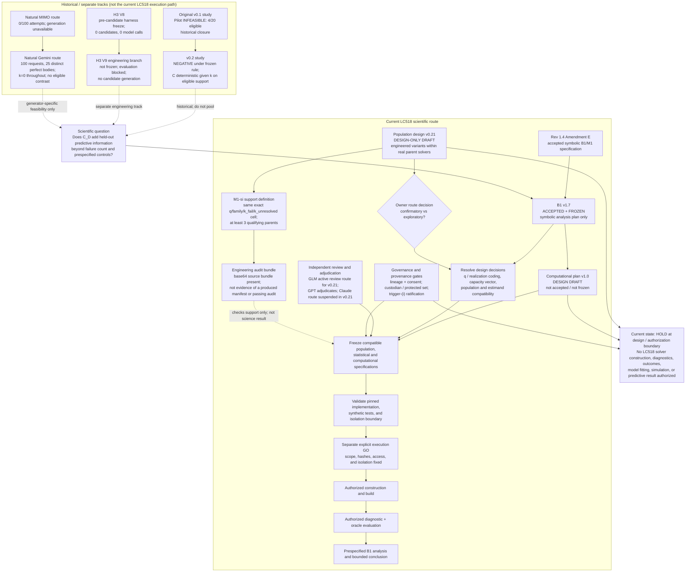

# Scientific roadmap and repository evidence audit

**Snapshot date:** 2026-11-18  
**Repository:** `foued2/failure-concentration-study`  
**Audit base:** `master` at `33dca9b61d95b9fb750f750919c32c2e08b2ee90`  
**Artifact status:** documentation-only audit and roadmap; not a protocol, scientific decision, freeze, or execution authorization.

## 1. Executive finding

The repository contains several distinct research and engineering tracks. They must not be treated as one linear experiment, and branch/file volume must not be mistaken for scientific progress.

The live LC518 statistical foundation is more mature than the implementation state:

- **B1 analysis plan v1.7 is accepted and frozen as a symbolic analysis plan.** It is not an execution GO and supports a conditional inference target, not a claim about a new-parent population.
- **Population and experimental design v0.21 is a design-only draft.** It proposes engineered variants nested within selected real parent solvers, but it does not select parents, select or allocate mutation mechanisms, create solver bodies, or authorize source access or execution.
- **B1 computational implementation plan v1.0 is not accepted or frozen.** Its implementation details do not authorize probability calculations, model fitting, simulation, or evaluation.
- **The November 6 mutation allocation remains unestablished.** The five-PDF search review reports aggregate arithmetic and audit criteria, but no named eight-mechanism taxonomy or complete pair-to-parent assignment. A standalone annex's existence is unproven; the evidence does not establish that it was lost, destroyed, or never created.
- **The proposed 30-parent × 5-variant / 150-variant design is not adopted.** The current v0.21 document expressly says neither the retired 90-version count nor the later 150-variant count is binding.
- **No LC518 solver-body population or solver outcomes are established by these design records.** The research question remains empirically unresolved.

The practical bottleneck is therefore not a missing final regression script. It is the unresolved transition from a frozen symbolic statistical question to an accepted, provenance-complete, implementable population and an explicitly authorized execution path.

## 2. Editable roadmap diagram

The diagram is Mermaid source, stored as ordinary Markdown so its nodes, labels, and dependencies remain editable.

**Reading rule:** the arrows after specification freeze are future dependencies, not work already completed. The diagram does not select the confirmatory or exploratory route. The Claude exploratory alternative is a proposal only; it is not an adopted protocol.

## 3. Repository coverage and evidence standard

### 3.1 Fixed base and branch structure

The default branch is `master`, at commit `33dca9b61d95b9fb750f750919c32c2e08b2ee90`. Its recursive Git tree contains **308 tracked files**. The live branch enumeration returned **60 branches** (not 59).

The following branch-tip inventories were checked as distinct evidence locations:

| Branch / tip | Tracked files in recursive tree | Role |
|---|---:|---|
| `master` / `33dca9b` | 308 | Original study, v0.2 record, shared root materials, and Nov. 10 mutation-search review |
| `gpt/b1-computational-plan-2026-11-14` / `46d548f` | 379 | B1 v1.7, Rev 1.4, computational plan drafts, and population-design version history |
| `gpt/lc518-m1si-audit-2026-11-17` / `7365ad5` | 386 | Mirrored v0.21 decision record, GLM/GPT adjudications, and M1-si audit-bundle source chunks |
| `gate/h3-footprint-v8-2026-10-27` / `d5b002c` | 2,314 | H3 V2–V8 engineering and validation history |
| `dev/h3-footprint-v9-implementation-2026-10-28` / `682a40d` | 2,770 | H3 V9 security/measurement implementation and earlier H3 history |
| `exploratory/natural-solver-feasibility-pilot` / `766b378` | 2,132 | Natural-solver feasibility, generation, integration, and runner records |

Counts are Git tree entries at those tips, not counts of independent experiments or unique scientific observations. Many branches retain common histories and repeated generated fixtures. Adding the counts together would double-count shared blobs and repeated artefacts.

### 3.2 What “audited” means here

The audit verified branch names/tips and recursive tree inventories for the principal evidence branches above, then read decision-bearing protocols, acceptance records, review dispositions, status files, and relevant feasibility reports by content. It also compared the claims in the November 10 mutation-search review with the later design record.

This is **not** a claim that every line of every generated solver, every binary/archive, every raw event, or every repeated H3 fixture across all 60 branch tips was independently re-executed or semantically reviewed. Tree inventory establishes file/path/blob presence; it does not establish that a program works, that an archived claim is true, or that an artifact has scientific validity. Where only an embedded or reported artifact identity is available, the roadmap preserves that limitation.

### 3.3 Decision-bearing source records

| Record | Repository identity / location | What it establishes |
|---|---|---|
| B1 v1.7 analysis plan | blob `8c666e501a31726c728447d155045c0b20adc178`; [plan](https://github.com/foued2/failure-concentration-study/blob/c3abe107acd2a3f8be58bf933eafcd734823a129/lc518-150/review-v1.2/b1-m1-joint-incidence-feasibility/B1_ANALYSIS_PLAN_2026-11-14_v1.7.md) | Symbolic B1 analysis plan |
| B1 v1.7 acceptance record | blob `ea51d72f4f85c5d832d72add561b4c93472c364a`; [acceptance record](https://github.com/foued2/failure-concentration-study/blob/ac06c6676982eed795db9cb04c6d91803b591ac7/lc518-150/review-v1.2/b1-m1-joint-incidence-feasibility/GPT_ACCEPTANCE_RECORD_B1_ANALYSIS_PLAN_V1.7_2026-11-14.md) | Explicitly accepts/freezes v1.7 as symbolic only |
| Rev 1.4 Amendment E | blob `3728146356a74363a94fe75a87fd06c483954ee2`; [specification](https://github.com/foued2/failure-concentration-study/blob/b8b8af042c16eeb9e02077c781ab05c582eeb65d/lc518-150/review-v1.2/b1-m1-joint-incidence-feasibility/B1_M1_JOINT_INCIDENCE_FEASIBILITY_SPEC_2026-11-12_v1.4.md) | Accepted symbolic predecessor for B1/M1; not an execution authorization |
| Computational plan v1.0 | blob `8b61952d70a3a4a60cd677e507b78dfae4f568ad`; [plan](https://github.com/foued2/failure-concentration-study/blob/3d9006d213c047b21d868d51ddf2f457fbf14b5a/lc518-150/review-v1.2/b1-m1-joint-incidence-feasibility/B1_COMPUTATIONAL_IMPLEMENTATION_PLAN_2026-11-14_v1.0.md) | Detailed implementation draft; expressly not accepted/frozen/GO |
| Population design v0.21 | blob `8af908f6b0ad4cd060194a0a63f4914939f07756`; [specification](https://github.com/foued2/failure-concentration-study/blob/7365ad5138595cd82736d325aea3fee28c85bcc0/lc518-150/review-v1.2/b1-population-design/POPULATION_AND_EXPERIMENTAL_DESIGN_2026-11-16_v0.21.md) | New population/design proposal and explicit non-authorization |
| GPT S25 bounded adjudication | blob `9f0f91b008bb48edcbfb3d5c11cb37514a903378`; [adjudication](https://github.com/foued2/failure-concentration-study/blob/7365ad5138595cd82736d325aea3fee28c85bcc0/lc518-150/review-v1.2/b1-population-design/GPT_ADJUDICATION_GLM_S25_SCAFFOLD_2026-11-17.md) | Technical scaffold, not owner ratification or a gate pass |
| M1-si engineering README | blob `bd4083bdbfdc099367535aa1effbe8620310e371`; [README](https://github.com/foued2/failure-concentration-study/blob/7365ad5138595cd82736d325aea3fee28c85bcc0/lc518-150/engineering/README.md) | Describes a utility restored from five Base64 chunks; synthetic software utility only |
| Expanded Nov. 6 mutation search | blob `51bff158b28da12d005675b29545274c582fc1f8`; [review](https://github.com/foued2/failure-concentration-study/blob/33dca9b61d95b9fb750f750919c32c2e08b2ee90/reviews/AI_REVIEW_2026-11-10_MUTATION_ALLOCATION_SEARCH.md) | Five-PDF source-bounded search and its limitations |
| H3 V8 freeze record | blob `56eb365adfe2d17f7494b71ab97bb0ff11fbb4fb`; [freeze](https://github.com/foued2/failure-concentration-study/blob/d5b002cf0802b54b5a18b81e6bb99a9566cdd5ff/h3-footprint-v8/FREEZE.json) | Pre-candidate harness freeze; no candidates or model calls |
| H3 V9 status | blob `c618e99732b8f8da825d20f126f78cfc31548a5c`; [status](https://github.com/foued2/failure-concentration-study/blob/682a40dab3f950fafe10365c6ec3f396e0e6389f/h3-footprint-v9/STATUS.json) | Engineering gate ledger; evaluation and generation remain blocked |
| Natural MIMO feasibility report | blob `4e6cfbb83bca1d64b3f4df275fa2961dd12df14f`; [report](https://github.com/foued2/failure-concentration-study/blob/766b3788d22b8591b24020753f71fd9a17875d7a/natural-feasibility-pilot/FEASIBILITY_REPORT.md) | MIMO generation unavailable; 0/100 attempts; no solver evaluation |
| Natural Gemini closure | blob `b2a6a1c0e5ecb02329de8cd62e04d4ab29ab3c9f`; [closure](https://github.com/foued2/failure-concentration-study/blob/d5b002cf0802b54b5a18b81e6bb99a9566cdd5ff/natural-feasibility-pilot/GEMINI_FEASIBILITY_CLOSURE_2026-10-21.md) | Generator-specific no-contrast result under one declared procedure |

## 4. Scientific status by track

### 4.1 Original v0.1 / v0.2 study: historical closure

The root README records that the original v0.1 pilot failed its yield gate (4/20 eligible against a requirement of at least 15) and that v0.2 was negative under its frozen rule, with (C_D) deterministic given (k) on the eligible support. These results explain why the original route was stopped. They are not results from the later LC518 design and must not be silently pooled with it.

### 4.2 LC518 B1: a defined question, no empirical answer yet

The controlling question is whether diagnostic concentration (C_D) adds held-out predictive information beyond failure count and the prespecified competing variables, within the declared support and conditioning structure.

B1 v1.7 is accepted and frozen as a **symbolic analysis plan**. Its conditional randomization test is conditional on the realized parents, outcomes, cells, and exposure multisets. It does not establish parent-superpopulation uncertainty or generalization to new parent implementations. The plan is not permission to run the permutation reference, numerical probabilities, models, simulation, solver construction, mutation allocation, or bank reuse.

The 78-record bank is development material, not a sealed confirmatory evaluation set. Its existence does not mean that the new parent/variant population has been built or evaluated.

### 4.3 Population design v0.21: proposed engineered population, still a draft

V0.21 proposes a deliberately engineered population of variants nested within provenance-traceable real parent solver implementations. Any resulting claim would be conditional on the selected parents and realized variants; it would not generalize to naturally occurring solvers.

The document explicitly records that:

- no parent implementation has been selected;
- no mechanism has been selected or assigned;
- no solver body has been created, modified, built, or run;
- no diagnostics, outcome records, model fits, simulations, or samples have been generated or evaluated;
- the 90-version and 150-variant counts are not binding;
- the protected-confirmatory route lacks an independent custodian;
- joint-consent provenance remains open; and
- the statistical interpretation of trigger (i) remains unratified.

The v0.21 review route names GLM as active and the Claude route as suspended by owner direction; GPT adjudicates GLM review. The separate Claude exploratory alternative is a document-only proposal. It does not choose the route or establish owner-set thresholds. No confirmatory-versus-exploratory choice or operating parent count is settled in the cited records.

### 4.4 M1-si: structural support rule, not a result

The v0.21 M1-si rule requires at least three qualifying parents to contribute matched variants in the **same exact cell** ((q, family, k_{fail}, k_{unresolved})). The engineering README describes the within-parent pair as requiring distinct runnable variants that differ in realization settings, exact (C_D), semantic-source digest, and runnable-artifact digest. Cells are not pooled.

The M1-si helper exists in the branch as a five-part Base64 ZIP bundle, with a documented ZIP digest and extracted-file digests. The repository snapshot reviewed here does not contain the restored source files as ordinary tracked files. The README describes synthetic tests, but this audit did not restore the bundle, run its tests, or audit a produced manifest. Therefore there is no demonstrated M1-si support pass.

A support pass, when lawfully run on a properly produced manifest, would establish only the structural support condition. It would not establish model-fit availability, predictive evidence, population representativeness, or causality.

### 4.5 November 6 mutation allocation: existence and contents remain unproven

The Nov. 10 review is explicitly bounded to five supplied conversation PDFs (Parts 4–8, 463 PDF pages). It reports that expanded searches found no named eight-mechanism taxonomy, no M01–M08 definitions, and no pair-to-parent assignment. The aggregate statements about a 28+2 schedule, G01–G30 roster, seven appearances per mechanism, and S-extra totals do not identify any mechanism or connect any pair to a parent.

Part 8's earlier assertion that the decisions had been made in conversation is later corrected in the same source sequence: the status is unknown, and the complete allocation is not established. The review does not independently search every prior chat, email, machine, backup, or unprovided archive.

**Correct status:** standalone annex existence unproven; complete allocation not established. Do not reconstruct it from totals, infer that it was destroyed, or treat a filename or search narrative as evidence of its contents.

### 4.6 H3: separate engineering experiment, not LC518 evidence

H3 V8's freeze record is explicitly pre-candidate: candidate generation was not performed, candidate count was zero, model calls were zero, and the scientific status says no H3 conclusion. The V9 branch is an engineering implementation branch, not frozen; its status record says the Sandbox two-token rendezvous remains failed, isolation validation is partial, the verdict/support-cell layer is not implemented, generation is blocked, and evaluation is blocked. A passing host unit-test suite does not turn those Sandbox gates into a pass.

H3 artifacts may inform engineering lessons about containment, instrumentation, and fail-closed execution. They do not provide LC518 outcomes or a concentration-prediction result.

### 4.7 Natural-solver feasibility: two distinct generator outcomes

The MIMO status report records 0 of 100 generation attempts, zero executable bodies, and no solver execution because the invocation mechanism and enforceable isolation were unavailable. Its terminal state is `BLOCKED_GENERATION_UNAVAILABLE`, not “infeasible within 100 attempts.”

The later Gemini closure records 100 requests, 25 distinct canonical bodies, 75 duplicate requests skipped without replacement, and 25 complete bodies that were all correct on both suites with (k=0) and (C_D=0). There were no eligible fixed-(k), different-(C_D) contrasts. This is a bounded, generator-specific feasibility finding under that task, prompt, instrument, and request cap. It is neither evidence against the concentration hypothesis nor a test of the LC518 engineered-parent design.

## 5. Critical dependencies before LC518 execution

These are dependencies, not permission to begin execution:

1. **Owner route and target decision.** Decide whether the next study is exploratory feasibility or a confirmatory design. State the target population and the role of the exposed 78-record development bank versus any genuinely protected evaluation set.
2. **Close the population specification.** Resolve the v0.21 open issues, including (q) and realization coding, the capacity vector, same-cell M1-si interpretation, lineage rules, and source/site equivalence. Obtain the required independent GLM review and GPT adjudication, then record the owner's adoption/freeze decision.
3. **Resolve provenance and custody.** Establish admissible parent-source provenance, joint consent, a reproducible lineage inventory, and (for any protected-confirmatory route) an independent custodian and protected-set governance. None is supplied by an engineering or statistical document.
4. **Make the statistical and computational plans compatible.** v1.7 is frozen for its stated symbolic/development-bank target; a new population or protected set requires an explicit compatibility decision and, where needed, an accepted amendment. Ratify or reject the trigger-(i) interpretation. The computational plan v1.0 must be independently reviewed, revised if necessary, accepted, and validated on the actual declared dimensions.
5. **Freeze and validate the measurement/construction machinery.** Complete the source-frame, Stage 1/Stage 2 profile, operator-specific catalog, search predicate, known-answer fixture battery, independent reference enumeration, variant identity/lineage checks, diagnostic instrument and capacity rules. A helper script or synthetic fixture pass cannot replace these gates.
6. **Validate isolation and deterministic operation.** Pin the numerical/build stack, verify the exact fail-closed execution path, resource ceilings, output provenance and cleanup. Keep generated solvers outside the trusted host process and data boundary.
7. **Obtain a separate explicit execution GO.** The GO must specify the exact scope, inputs, artifact hashes, environment, access permissions, isolation, and authorized actions. Passing a design review or freezing a document is not a GO.
8. **Only then generate and evaluate.** Preserve all exclusions, invalid attempts, missingness, and shortfalls. Do not add, repair, reassign, or selectively replace variants after observing diagnostic or correctness results. Run the prespecified analysis only after the authorized data collection and audit pass.

## 6. Current stop line and non-claims

At this snapshot, the defensible state is:

- the B1 symbolic analysis plan is accepted/frozen;
- the B1 computational plan is still a draft;
- population design v0.21 is still a design-only draft under GLM review;
- the mutation allocation is not established;
- the 150-variant proposal is not adopted;
- no parent roster or M1-si manifest has been shown to pass;
- no protected-set custodian or complete joint-consent record is established;
- no LC518 solver population, diagnostic outcomes, correctness outcomes, or B1 predictive result is demonstrated; and
- no LC518 execution is authorized by these records.

**Do not report “the concentration hypothesis failed.” Do not report “the 150-solver experiment is ready.” The supported conclusion is that the hypothesis remains unresolved and the LC518 design-to-execution transition remains blocked by population, provenance, computational-validation, custody, and authorization gates.**

## 7. Scope and maintenance

This file is a navigational synthesis of the cited repository records as of 2026-11-18. It does not supersede any source record, resolve any open decision, change a frozen document, authorize work, or merge any research branch. Update it only by adding a dated audit revision that records the new source commit/blob identities and distinguishes changed facts from unchanged historical evidence.

The `docs/scientific-roadmap-audit-2026-11-18` branch is intentionally separate from `master`. No source, protocol, freeze record, solver, bank, or outcome artifact is modified by this roadmap.
